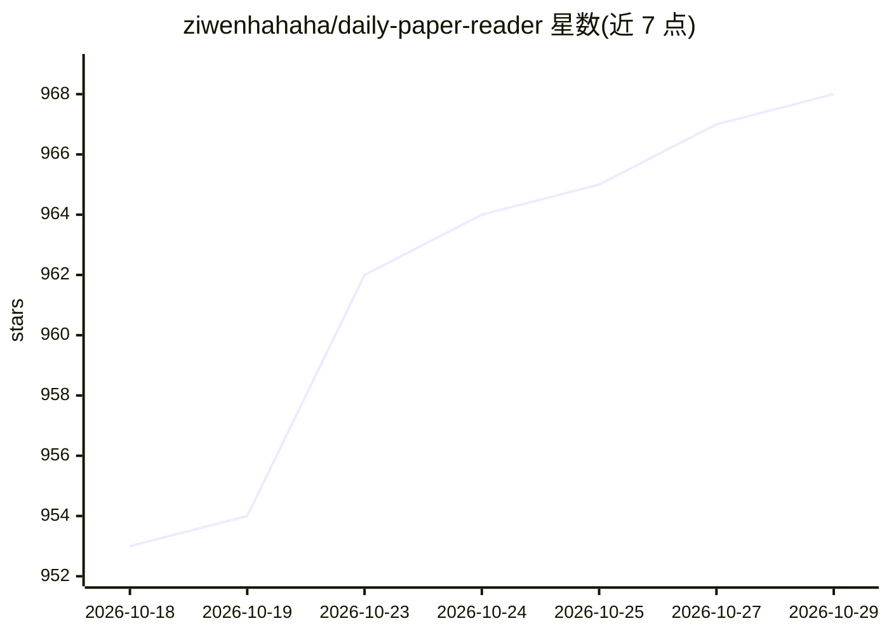

# ziwenhahaha/daily-paper-reader

⭐ 968 · Python · MIT · 推送 2026-10-05 · [GitHub](https://github.com/ziwenhahaha/daily-paper-reader) · [官网](https://ziwenhahaha.github.io/daily-paper-reader/) · 个人维护 · 中文 README

**每日 arXiv/OpenReview 论文推荐与 AI 阅读的自部署平台**

面向个人研究者与实验室的论文发现、阅读与问答平台：通过 GitHub Actions 每日抓取 arXiv/OpenReview 等多源论文，基于关键词与研究方向生成个性化推荐流，支持摘要/原文/总结串联阅读与 AI 论文问答；另接入 9 大会议论文检索（NeurIPS/ICML/ACL 等）。部署方式为 Fork 仓库后开启 Actions 与 Pages，无需服务器，LLM 环节以 DeepSeek API 为默认配置；亦提供本地调试后端脚本。

## 筛选速览

| 维度 | 判定 | 备注 |
|---|---|---|
| AI 角色 | `ai-native` | 本体是模型或模型工具 |
| 许可风险 | `permissive` | MIT |
| 部署形态 | `None` |  |
| 模型依赖 | locked-api |  |
| 硬件要求 | — | 无带数字的原话,不猜 |
| 安装摩擦 | `medium` | 含编译或系统依赖之一 |
| 成熟度 | — | 结构信号不足 |

## 能力要点

- GitHub Actions + Pages 零服务器部署，Fork 后少量配置即可上线
- 每日自动抓取 arXiv / OpenReview 并生成个性化推荐流
- AI 论文问答与摘要、原文、长总结同页阅读
- 接入 NeurIPS/ICML/ACL 等 9 大会议论文检索

## 适用场景

- 持续追踪自己研究方向的新论文
- 搭建实验室公共论文面板
- 边读论文边 AI 问答并沉淀讨论记录

## 场景标签

`科研工具` `文档问答` · 领域:知识与检索

## 证据(README 行号)

> L107: - **🔎 Daily Paper Radar**：每日自动抓取 arXiv / OpenReview 新论文，持续追踪研究前沿。
> L110: - **💬 Ask While Reading**：支持 AI 论文问答，边读边问，沉淀私人讨论记录。

## 星数曲线

2026-10-18 953 → 2026-10-29 968（+15）

---
*卡片 v1 · prompt 1.4 · 生成 2026-10-21 · 置信度 high · 依据 README sha `3127b9da0c55` · [字段定义](../../DATASET.md)*
