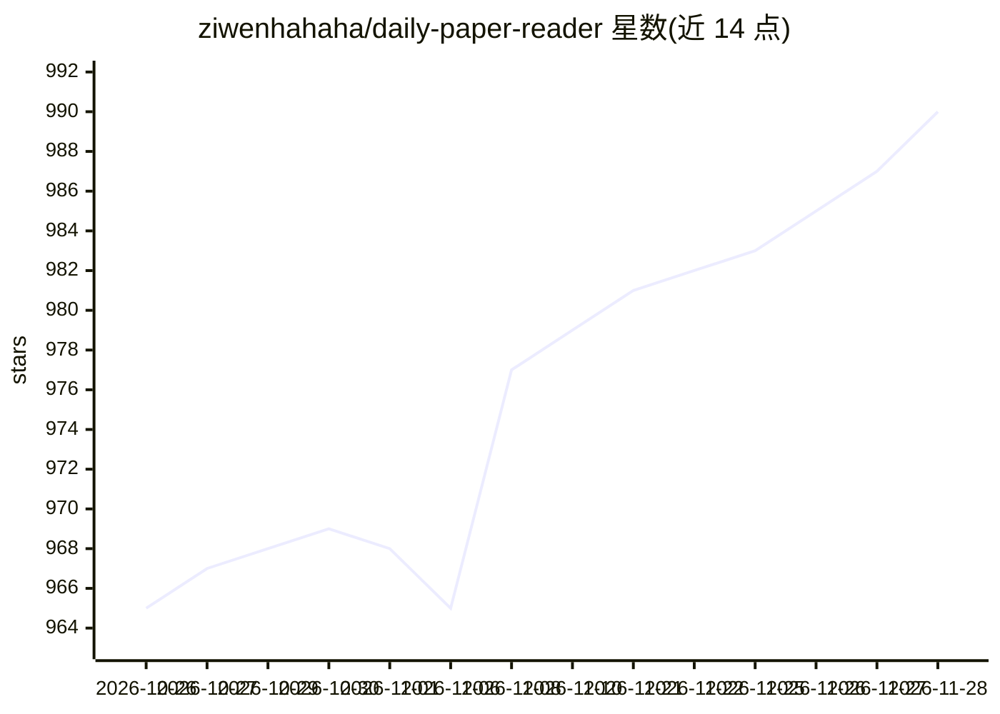

# ziwenhahaha/daily-paper-reader

⭐ 990 · Python · MIT · 推送 2026-11-27 · [GitHub](https://github.com/ziwenhahaha/daily-paper-reader) · [官网](https://ziwenhahaha.github.io/daily-paper-reader/) · 个人维护 · 中文 README

**个人/实验室的每日 arXiv 论文推荐与 AI 阅读问答平台**

每日自动抓取 arXiv / OpenReview 及会议论文，按订阅关键词与研究方向生成个性化推荐流，提供摘要、速览、长总结同页阅读与论文 AI 问答。部署方式为 Fork 后经 GitHub Actions 自动更新、GitHub Pages 托管，无需自备服务器；也提供本地调试后端脚本。默认以 DeepSeek API 为 LLM 环节（过滤、精读摘要、问答），重排用本地 Qwen3-Reranker，embedding 用 bge-small 或公益远端服务；DeepSeek 调用按用量计费。

## 筛选速览

| 维度 | 判定 | 备注 |
|---|---|---|
| AI 角色 | `ai-native` | 本体是模型或模型工具 |
| 许可风险 | `permissive` | MIT |
| 部署形态 | `None` |  |
| 模型依赖 | locked-api |  |
| 硬件要求 | — | 无带数字的原话,不猜 |
| 安装摩擦 | `medium` | 含编译或系统依赖之一 |
| 成熟度 | — | 结构信号不足 |

## 能力要点

- 每日抓取 arXiv / OpenReview 与 9 大会议论文，按 tag 维护推荐流
- AI 论文问答、中文翻译、精读长总结与 PDF 图表提取
- Fork 即用：GitHub Actions 更新 + GitHub Pages 部署，零服务器
- 支持 90/365 天专题回溯与实验室/团队论文面板

## 适用场景

- 持续追踪自己研究方向的新论文
- 为实验室搭建公共论文面板
- 把发现、阅读、问答、总结集中到一个入口

## 场景标签

`推荐系统` `科研工具` · 领域:学习与行业

## 证据(README 行号)

> L110: - **🔎 Daily Paper Radar**：每日自动抓取 arXiv / OpenReview 新论文，持续追踪研究前沿。
> L113: - **💬 Ask While Reading**：支持 AI 论文问答，边读边问，沉淀私人讨论记录。
> L114: - **🚀 Zero-Server Deployment**：依托 GitHub Actions 自动更新、GitHub Pages 部署，无需额外服务器。

## 星数曲线

2026-10-26 965 → 2026-11-28 990（+25）

---
*卡片 v1 · prompt 1.4 · 生成 2026-11-26 · 置信度 high · 依据 README sha `3003d7ffab98` · [字段定义](../../DATASET.md)*
