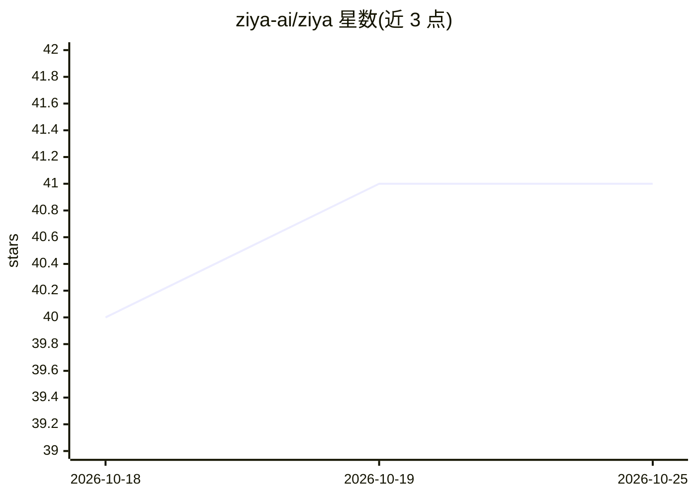

# ziya-ai/ziya

⭐ 41 · Python · MIT · 推送 2026-10-14 · [GitHub](https://github.com/ziya-ai/ziya) · [官网](https://github.com/ziya-ai/ziya) · 个人维护

**自托管本地 AI 技术工作台：聊天 UI 与编码 agent 合一**

运行在本机的自托管工具，将浏览器端聊天界面与编码 agent 合并：直接读取磁盘上的项目文件，以可点击应用/撤销的 diff 提出代码变更，运行 shell 工具与 `ziya shadow ssh` 包裹的终端，内联渲染依赖图、时序图与数据包布局等可视化结果。支持多线程并行工作、线程持久化/分叉/交接摘要，可接入 PDF、Office 文档与抓包文件。模型方面支持 Bedrock、Anthropic、OpenAI、Gemini、z.ai 及 Ollama/LM Studio 本地模型，可在线程中途切换。工具结果经密码学签名以防伪造输出。以 pip 安装，MIT 许可，无账号无遥测。README 自述由某大型科技公司数百名工程师日常使用。

## 筛选速览

| 维度 | 判定 | 备注 |
|---|---|---|
| AI 角色 | `ai-native` | 本体是模型或模型工具 |
| 许可风险 | `permissive` | MIT |
| 部署形态 | `library` | 以包/库形式分发 |
| 模型依赖 | local-ok | 支持本地模型 |
| 硬件要求 | — | 无带数字的原话,不猜 |
| 安装摩擦 | `low` | 无编译、无系统依赖或容器化 |
| 成熟度 | — | 结构信号不足 |

## 能力要点

- 读取磁盘项目文件，产出可一键应用/撤销的已验证 diff
- 多线程并行：每个线程独立文件、模型与历史，支持分叉与可编辑交接摘要
- 支持 Bedrock/Anthropic/OpenAI/Gemini/z.ai/Ollama/LM Studio，可在线程中途切换模型
- 工具结果密码学签名，拒绝伪造的工具输出；`ziya shadow ssh` 包裹终端并按白名单执行

## 适用场景

- 在本地用任意模型（含本地 Ollama）做代码修改与 diff 审查
- 同时推进多个技术调查、迁移与设计任务并长期保持上下文
- 将 PDF、Office 文档、抓包文件直接纳入对话分析
- 生成并查看依赖图、时序图等结构化可视化

## 场景标签

`编码 Agent` `代码审查` `AI 助手` `文档问答` · 领域:编码与开发

## 证据(README 行号)

> L1: A self-hosted AI harness for technical work — the chat UI and the coding agent in one local tool.
> L16: - **Use any model, and switch mid-thread.** Bedrock, Anthropic, OpenAI, Gemini, z.ai, or a local model through Olla
> L19: `pip install ziya`, then run `ziya` in your project and open `localhost:6969`. Quick start · Coming from another to

## 星数曲线

2026-10-18 40 → 2026-10-25 41（+1）

---
*卡片 v1 · prompt 1.4 · 生成 2026-10-25 · 置信度 high · 依据 README sha `943e6d2728f1` · [字段定义](../../DATASET.md)*
