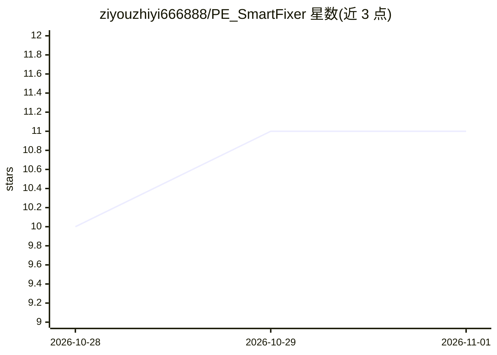

# ziyouzhiyi666888/PE_SmartFixer

⭐ 11 · Go · GPL-3.0 · 推送 2026-10-27 · [GitHub](https://github.com/ziyouzhiyi666888/PE_SmartFixer) · 个人维护 · 中文 README

**给维修技术员的 WinPE AI 视觉蓝屏诊断与离线注册表修复工具**

纯 Go 编写的 Windows PE 离线维护工具：用户输入故障文字并可选上传蓝屏/报错截图，通过阿里云百炼 API 调用 Qwen-VL 多模态模型生成诊断建议，再由程序对离线系统执行注册表修复（REG|服务名）与系统文件补全（FILE|文件名|路径）。配套四层安全白名单、修改前 .reg 备份、目标盘黑匣子记忆文件与多阶段失败熔断/自动回滚机制。需联网调用云端 AI，不能修复硬件物理故障、引导记录损坏与 BitLocker 锁定系统。以个人免费+商业 PE 厂商需授权的分发模式提供。

## 筛选速览

| 维度 | 判定 | 备注 |
|---|---|---|
| AI 角色 | `ai-enhanced` | 去掉 AI 部分产品仍成立 |
| 许可风险 | `dual` | GPL-3.0 |
| 部署形态 | `desktop` | 安装包/桌面程序 |
| 模型依赖 | — | README 未给出锁定关系 |
| 硬件要求 | — | 无带数字的原话,不猜 |
| 安装摩擦 | `low` | 无编译、无系统依赖或容器化 |
| 成熟度 | — | 结构信号不足 |

## 能力要点

- Qwen-VL 多模态视觉诊断蓝屏截图，输出三级风险建议（SAFE/WARNING/CRITICAL）
- 离线注册表 Hive 挂载执行 REG|服务名 与 FILE|文件名 修复指令
- 目标盘 pe_fix_memory.json 长期记忆：24h 过期、3 次失败硬熔断、自动回滚上次改动
- 四层安全白名单：指令格式校验+服务名/文件名白名单+路径穿越防御

## 适用场景

- PE 环境下修复 0x0000007B 蓝屏（硬盘模式切换导致）
- 恢复被禁用的关键系统服务或补全缺失驱动文件
- 用蓝屏截图让 AI 给出修复方案并人工确认执行

## 场景标签

`多模态` · 领域:感知与多模态

## 证据(README 行号)

> L2: `版本: v1.1` │ `环境: WinPE` │ `核心: Go 语言 (无依赖)` │ `大脑: Qwen-VL (多模态 AI)` │ `协议: GPL-3.0 (开源)`
> L62: 1. **准备工作**：将 `PE_SmartFixer_amd64.exe` 和 `config.json` 放入同一目录。编辑 `config.json`，填入你的百炼 API Key：
> L70:  - 点击"🚀 开始诊断"，等待 AI 分析（约 10–60 秒）

## 星数曲线

2026-10-28 10 → 2026-11-01 11（+1）

---
*卡片 v1 · prompt 1.4 · 生成 2026-11-01 · 置信度 high · 依据 README sha `b837fe816eb4` · [字段定义](../../DATASET.md)*
