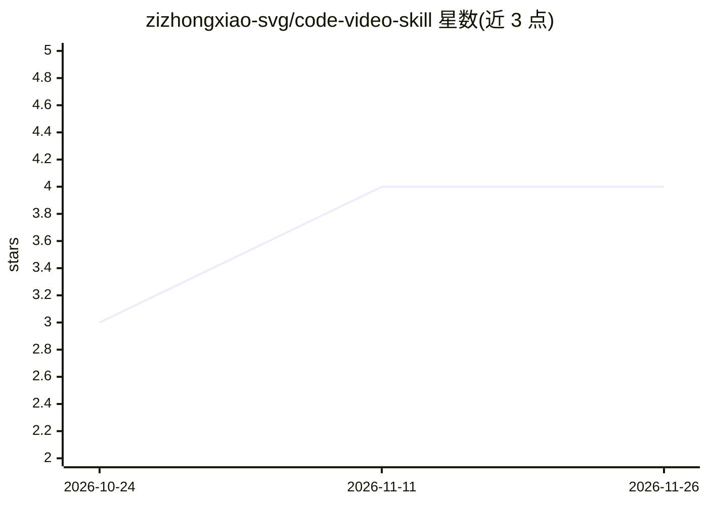

# zizhongxiao-svg/code-video-skill

⭐ 4 · Python · MIT · 推送 2026-10-19 · [GitHub](https://github.com/zizhongxiao-svg/code-video-skill) · 个人维护 · 中文 README

**让编码代理写代码逐帧渲染科普视频的 Agent Skill**

面向 Claude Code / Cursor / Codex 等编码代理的技能包：由 LLM 编写 Canvas/SVG/Three.js/WebGL 网页代码，无头浏览器逐帧确定性截图，ffmpeg 编码成短视频，不使用任何视频生成模型。内含 16 种画风的提示词与制作手记、16 段示例成片源码、起步模板、并行渲染脚本，以及 edge-tts 旁白、字幕合成、芯片音乐与卡点鼓点等脚本。需要 ffmpeg/ffprobe、Node 环境与中文字体。

## 筛选速览

| 维度 | 判定 | 备注 |
|---|---|---|
| AI 角色 | `ai-knowledge` | 知识聚合/清单类 |
| 许可风险 | `permissive` | MIT |
| 部署形态 | `library` | 以包/库形式分发 |
| 模型依赖 | — | README 未给出锁定关系 |
| 硬件要求 | — | 无带数字的原话,不猜 |
| 安装摩擦 | `medium` | 含编译或系统依赖之一 |
| 成熟度 | — | 结构信号不足 |

## 能力要点

- LLM 写代码逐帧渲染视频，每帧为时间 t 的纯函数，可复现、可并行、可单帧重渲
- 16 种画风附带精简/完整提示词、制作手记与事实依据，示例成片源码可直渲
- edge-tts 旁白+字幕、配乐自动避让人声、响度归一，代码合成音乐无版权问题
- 编码时自动选择 NVENC 或 x264

## 适用场景

- 让编码代理生成数据、公式准确的科普短视频
- 制作成语典故、地理比例尺等题材的讲解视频
- 低成本批量重渲染已定稿视频的个别画面

## 场景标签

`视频生成` · 领域:内容生成

## 证据(README 行号)

> L9: 一个给 Claude Code / Cursor / Codex 等编码代理用的 **Agent Skill**：
> L29: |`SKILL.md`|技能主文件：流程、页面合约、自检清单、命令|
> L30: |`references/styles/`|16 种画风：适合的题材、精简提示词、完整提示词、制作手记、事实依据|

## 星数曲线

2026-10-24 3 → 2026-11-26 4（+1）

---
*卡片 v1 · prompt 1.4 · 生成 2026-11-21 · 置信度 mid · 依据 README sha `eb08c231adac` · [字段定义](../../DATASET.md)*
