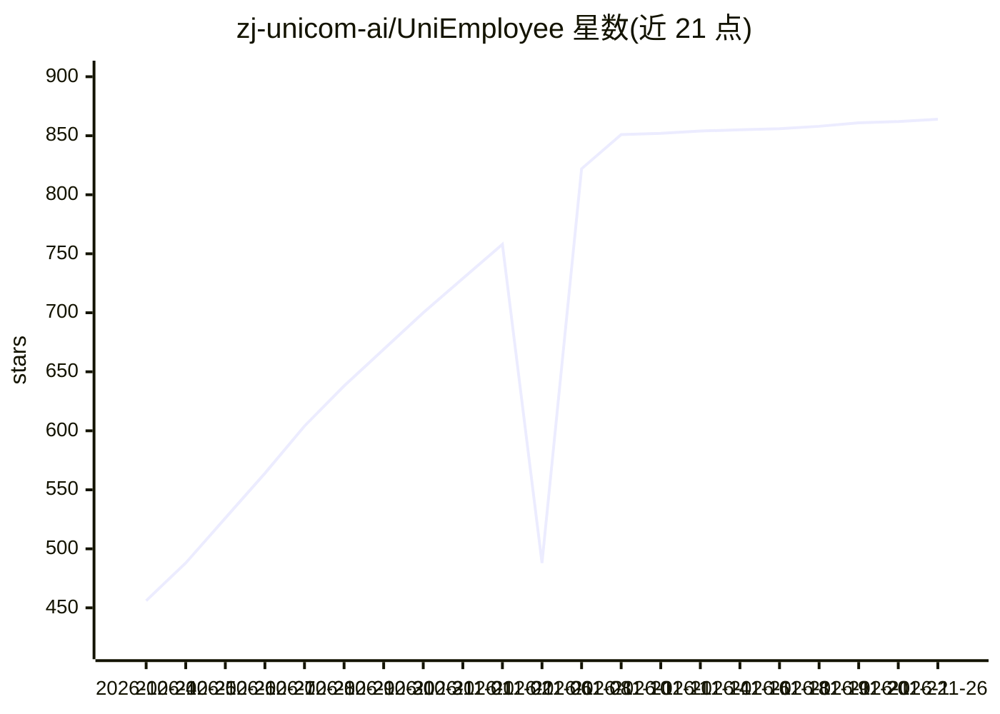

# zj-unicom-ai/UniEmployee

⭐ 864 · Python · MIT · 推送 2026-11-21 · [GitHub](https://github.com/zj-unicom-ai/UniEmployee) · 组织维护 · 中文 README

**面向企业的数字员工构建与运行平台**

企业级 Agent 平台：通过 Employee → Workflow/SOP → Skill → Connector → Tool 五层能力模型，把大模型编排为客服、销售、数据分析、HR、经营分析等岗位数字员工。关键机制包括 SKILL.md 技能规程播种、StateGraph 状态机含人工审批节点、按 (user_id, employee_id) 隔离的长期记忆、超长对话自动压缩、全链路 run/trace 可观测，以及 SQL 只读校验、工具白名单等安全护栏。需 OpenAI 兼容模型 API，自身不需 GPU；MIT 许可，另提供企业落地技术支持联系方式。

## 筛选速览

| 维度 | 判定 | 备注 |
|---|---|---|
| AI 角色 | `ai-native` | 本体是模型或模型工具 |
| 许可风险 | `permissive` | MIT |
| 部署形态 | `self-host` | docker 或自建部署 |
| 模型依赖 | locked-api |  |
| 硬件要求 | `cpu-ok` | |
| 安装摩擦 | `low` | 无编译、无系统依赖或容器化 |
| 成熟度 | — | 结构信号不足 |

## 能力要点

- 五层能力模型：Employee/Workflow/SOP/Skill/Connector/Tool 页面化配置
- HITL 人工审批中断恢复与敏感词、工具白名单多层护栏
- 超长对话自动压缩与跨会话长期记忆落盘
- 企业知识本体：实体/关系、多跳路径、来源溯源与审计

## 适用场景

- 把客服、销售、HR 等岗位流程固化为可审批的数字员工
- 在飞书、钉钉、企业微信等 IM 渠道接入企业 Agent
- 数据分析报告与经营分析的自动化生成

## 场景标签

`Agent 记忆` `数据分析` `工作流自动化` `知识图谱` · 领域:Agent 开发

## 证据(README 行号)

> L12: UniEmployee 是一套面向企业的**数字员工构建与运行平台**：把专业员工的工作经验、业务流程和判断标准，固化为可随时上岗、可配置、可审批、可观测的 AI 数字员工。通过 **Employee → Workflow/SOP
> L154: 编译期 `compiler.compile_agent()` 读取 catalog 中的员工配置，按需装配工具与连接器、拼接 system_prompt，最终经 `create_deep_agent()` 生成可运行 agent

## 星数曲线

2026-10-24 456 → 2026-11-26 864（+408）

---
*卡片 v1 · prompt 1.4 · 生成 2026-11-24 · 置信度 mid · 依据 README sha `ea898cc6618c` · [字段定义](../../DATASET.md)*
