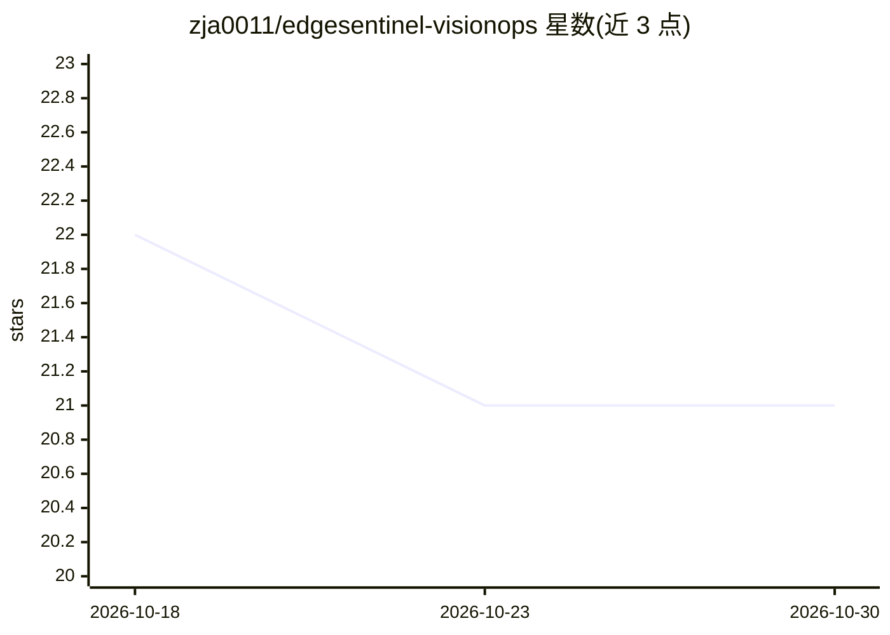

# zja0011/edgesentinel-visionops

⭐ 21 · Python · Apache-2.0 · 推送 2026-08-14 · [GitHub](https://github.com/zja0011/edgesentinel-visionops) · [官网](https://zja0011.github.io/edgesentinel-visionops/video-gallery.html) · 个人维护 · 中文 README

**Jetson Nano 边缘视觉 Agent 平台：实时视频分析+工具治理+灾备**

自托管的 Jetson Nano 边缘 AI 视频分析与 Agent Harness 平台，面向边缘智能开发者。功能覆盖实时目标检测与跟踪、人员计数、区域与库存事件、带 SHA-256 校验的事件证据、MCP 只读工具（25 个）、L0–L3 风险分级与 RBAC 的工具调用治理、DeepSeek 在线/确定性离线规则切换、熔断降级、加密备份与恢复演练。基于 FastAPI 提供 Dashboard，Docker 隔离、systemd 托管，含 660+ 单元测试与 CycloneDX SBOM。部署需 Jetson Nano、JetPack 4 与摄像头。

## 筛选速览

| 维度 | 判定 | 备注 |
|---|---|---|
| AI 角色 | `ai-native` | 本体是模型或模型工具 |
| 许可风险 | `permissive` | Apache-2.0 |
| 部署形态 | `None` |  |
| 模型依赖 | locked-api |  |
| 硬件要求 | — | 无带数字的原话,不猜 |
| 安装摩擦 | `low` | 无编译、无系统依赖或容器化 |
| 成熟度 | `idea` | |

## 能力要点

- 实时检测、跟踪、区域/库存事件与带完整性校验的证据链
- Agent Harness：33 Tools / 25 MCP Tools / 6 Hooks，L0–L3 风险分级与默认拒绝
- DeepSeek 在线模式与确定性离线规则受控切换、熔断与恢复
- 加密异机备份、恢复演练与 CycloneDX 1.7 SBOM 可验证发布

## 适用场景

- 在 Jetson Nano 上搭建可治理的实时视频监控与事件系统
- 通过对话让 Agent 查询视觉状态并受控调用本地/外部工具
- 在弱网或模型不可用时保持边缘服务降级运行并演练恢复

## 场景标签

`目标检测` · 领域:感知与多模态

## 证据(README 行号)

> L19: EdgeSentinel VisionOps 不是“摄像头接一个大模型”的一次性脚本。它把**实时视觉、结构化事件、证据链、Agent 工具调用、MCP、权限策略、模型降级、可观测性与灾难恢复**组织成一套可验证的边缘智能体工程。
> L42: EdgeSentinel VisionOps is a self-hosted **Jetson Nano edge AI video analytics and Agent Harness** platform. It comb
> L68: - Jetson Nano 实时目标检测、IoU 跟踪、人员计数与区域判断；

## 星数曲线

2026-10-18 22 → 2026-10-30 21（-1）

---
*卡片 v1 · prompt 1.4 · 生成 2026-10-28 · 置信度 high · 依据 README sha `24a9ccfd89ef` · [字段定义](../../DATASET.md)*
