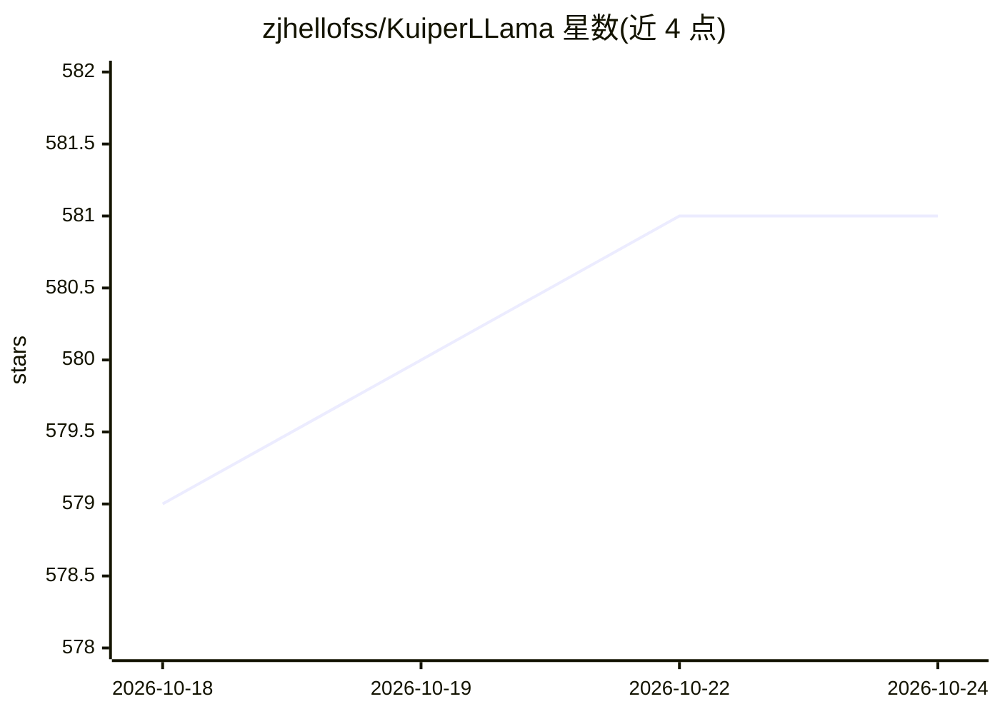

# zjhellofss/KuiperLLama

⭐ 581 · C++ · 推送 2025-10-28 · [GitHub](https://github.com/zjhellofss/KuiperLLama) · 个人维护 · 中文 README

**C++/CUDA 自制大模型推理框架教学项目，支持 Llama/Qwen**

面向校招与求职准备者的开源课程配套项目：从零实现大模型推理框架，代码采用 C++20 与 CMake 管理，支持 Llama2/3/3.2、Qwen2.5 与 Qwen3 模型推理，提供 CPU 算子与 CUDA 双后端及 Int8 量化。仓库提供模型导出脚本（export.py）、编译步骤与运行示例（llama_infer/qwen_infer），并以 huggingface 推理结果做对比验证；第三方依赖包括 glog、gtest、sentencepiece、armadillo+openblas 与 CUDA Toolkit。完整讲解与 Qwen2.5 模型获取需参加配套付费课程。

## 筛选速览

| 维度 | 判定 | 备注 |
|---|---|---|
| AI 角色 | `ai-ecosystem` | LLM/agent 周边工具 |
| 许可风险 | `none` | — |
| 部署形态 | `library` | 以包/库形式分发 |
| 模型依赖 | — | README 未给出锁定关系 |
| 硬件要求 | — | 无带数字的原话,不猜 |
| 安装摩擦 | `high` | 编译与系统依赖俱全 |
| 成熟度 | — | 结构信号不足 |

## 能力要点

- C++20 实现，CPU 算子与 CUDA 双后端，支持 Int8 量化
- 支持 Llama2/3/3.2、Qwen2.5、Qwen3 系列模型推理
- 提供 export.py 等模型导出脚本与 HuggingFace 结果对比验证
- 实测 Llama1.1b fp32 在 RTX 3060 laptop 上 60.34 token/s

## 适用场景

- 校招/秋招准备者动手学习大模型推理框架的实现原理
- 学习现代 C++ 项目设计、单元测试与 Benchmark 用法
- 在本地 GPU 上运行 Llama/Qwen 模型并验证推理结果

## 场景标签

`教程课程` `推理引擎` · 领域:学习与行业

## 证据(README 行号)

> L1: # KuiperLLama 动手自制大模型推理框架，支持LLama2/3和Qwen2.5
> L14: 4. CPU算子和CUDA双后端实现，对时新的大模型（LLama3和Qwen系列）有非常好的支持。
> L56: ## 生成文本的方法

## 星数曲线

2026-10-18 579 → 2026-10-24 581（+2）

---
*卡片 v1 · prompt 1.4 · 生成 2026-10-21 · 置信度 mid · 依据 README sha `b2b176af0c08` · [字段定义](../../DATASET.md)*
