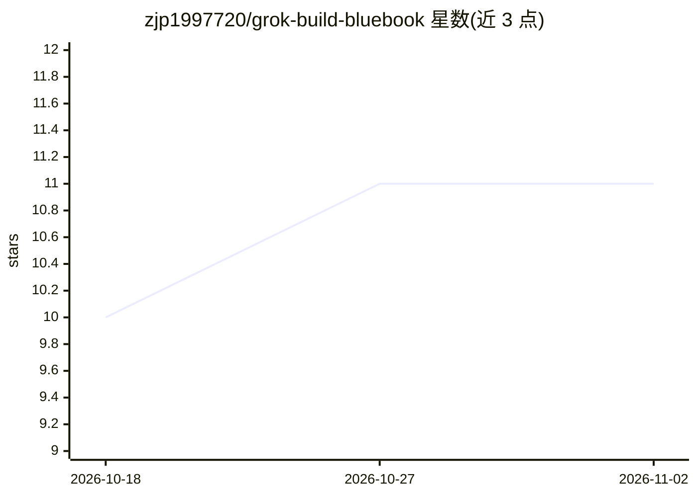

# zjp1997720/grok-build-bluebook

⭐ 11 · NOASSERTION · 推送 2026-08-15 · [GitHub](https://github.com/zjp1997720/grok-build-bluebook) · [官网](https://zjp1997720.github.io/grok-build-bluebook/) · 组织维护 · 中文 README

**面向零基础与 Claude Code/Codex 用户的 Grok Build 中文实战指南**

一本 150 页的中文电子书（PDF/HTML），从终端基础讲起，系统覆盖 Grok Build 的任务合同、上下文、权限、Skills、MCP、Hooks、Headless、CI、多 Agent 与自动化，配 12 个递进项目和可运行示例（examples/ 目录）。读者为零基础用户及从 Claude Code / Codex 迁移的用户，迁移部分区分可直接带走、需适配与必须重做的资产。内容冻结于 Grok Build CLI 1.0.3，资料截止 2026-08-15，更新版本需自行核对。正文以 CC BY-NC-SA 4.0 发布。

## 筛选速览

| 维度 | 判定 | 备注 |
|---|---|---|
| AI 角色 | `ai-knowledge` | 知识聚合/清单类 |
| 许可风险 | `none` | NOASSERTION |
| 部署形态 | `None` |  |
| 模型依赖 | — | README 未给出锁定关系 |
| 硬件要求 | — | 无带数字的原话,不猜 |
| 安装摩擦 | `low` | 无编译、无系统依赖或容器化 |
| 成熟度 | `idea` | |

## 能力要点

- 150 页全流程覆盖：从安装诊断到 Headless、CI 与多 Agent
- 12 个递进项目与可运行示例（含 CI 审查、迁移桥接样例）
- 版本边界明确：冻结于 Grok Build CLI 1.0.3，截止 2026-08-15
- PDF 与单文件自包含 HTML 免费下载

## 适用场景

- 零基础学习 Grok Build 并跑通第一个可验证任务
- 从 Claude Code / Codex 迁移到 Grok Build 时对照迁移矩阵
- 搭建 Coding Agent 的 CI 审查与自动化工作流时参考示例

## 场景标签

`教程课程` · 领域:学习与行业

## 证据(README 行号)

> L7: 一本面向零基础读者，以及 Claude Code / Codex 用户的 Grok Build 实战指南。
> L9: 全书 150 页，从第一次打开终端开始，逐步覆盖任务合同、上下文、权限、Skill、MCP、Hooks、会话恢复、Headless、CI、多 Agent、自动化与迁移，并配有 12 个递进项目和可运行示例。

## 星数曲线

2026-10-18 10 → 2026-11-02 11（+1）

---
*卡片 v1 · prompt 1.4 · 生成 2026-11-01 · 置信度 high · 依据 README sha `e5334b378242` · [字段定义](../../DATASET.md)*
