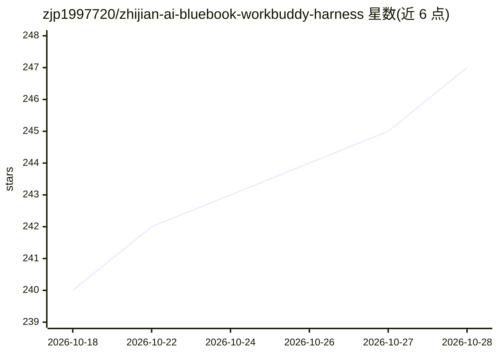

# zjp1997720/zhijian-ai-bluebook-workbuddy-harness

⭐ 247 · 推送 2026-08-16 · [GitHub](https://github.com/zjp1997720/zhijian-ai-bluebook-workbuddy-harness) · [官网](https://zjp1997720.github.io/zhijian-ai-bluebook-workbuddy-harness/) · 个人维护 · 中文 README

**拆解 WorkBuddy 提示词/记忆/插件/安全边界的蓝皮书（60页）**

智见 AI 蓝皮书系列 ZJBB-003 公开测试版 v0.1.0：一本 60 页、15 章 + 4 附录的电子书，从 UI 行为追溯到本地文件与请求拼装过程，拆解 WorkBuddy 5.3.13（macOS 实测）的提示词、三层记忆、插件、专家、Skill、Connector、SubAgent 与 Agents Team 机制，含 18 张机制图与五步配置排查路径。面向 WorkBuddy 深度用户、Agent 实践者、需要安全定制的工程师与讲师。以在线 HTML、PDF、单文件 HTML 三种形式交付；证据边界限定于 2026-08-15 前版本，声明与厂商无隶属关系，正文 CC BY-SA 4.0。

## 筛选速览

| 维度 | 判定 | 备注 |
|---|---|---|
| AI 角色 | `ai-knowledge` | 知识聚合/清单类 |
| 许可风险 | `none` | — |
| 部署形态 | `None` |  |
| 模型依赖 | — | README 未给出锁定关系 |
| 硬件要求 | — | 无带数字的原话,不猜 |
| 安装摩擦 | `low` | 无编译、无系统依赖或容器化 |
| 成熟度 | `idea` | |

## 能力要点

- 五层 Harness 模型：界面行为→本地文件→请求拼装的拆解方法
- 三层记忆、系统提示词拼装、身份四件套机制解释
- 五步路径（层级→优先级→缓存→同步→版本）排查配置不生效
- 插件供应链与隐私边界分析，附 Claude Code / Codex 设计对照

## 适用场景

- WorkBuddy 配置不生效或插件行为异常时按路径排查
- 理解插件、专家、Skill、SubAgent 之间如何注入系统提示词
- 把 Harness 机制讲给学员、同事或客户的培训材料

## 场景标签

`教程课程` · 领域:学习与行业

## 证据(README 行号)

> L15: WorkBuddy 很容易上手，也很容易在深入使用后碰到一堵看不见的墙：它为什么记住了这件事？插件往主线程里注入了什么？改了配置为什么不生效？专家、Skill、Connector、SubAgent 和 Agents Team 到底
> L17: 这本书不复述按钮怎么点。它沿着一条更有用的路径往下拆：**从界面行为找到本地文件，再从本地文件还原一次请求是怎样被拼装出来的。**
> L21: |公开测试版 v0.1.0|60 页 · 15 章 + 4 附录|18 张机制图|WorkBuddy 5.3.13 · macOS 本地实测|
> L57: |四、安全与生态坐标|第 12—13 章|插件供应链、隐私边界，以及与 Claude Code / Codex 的设计对照|

## 星数曲线

2026-10-18 240 → 2026-10-28 247（+7）

---
*卡片 v1 · prompt 1.4 · 生成 2026-10-22 · 置信度 high · 依据 README sha `154930c4dcf4` · [字段定义](../../DATASET.md)*
