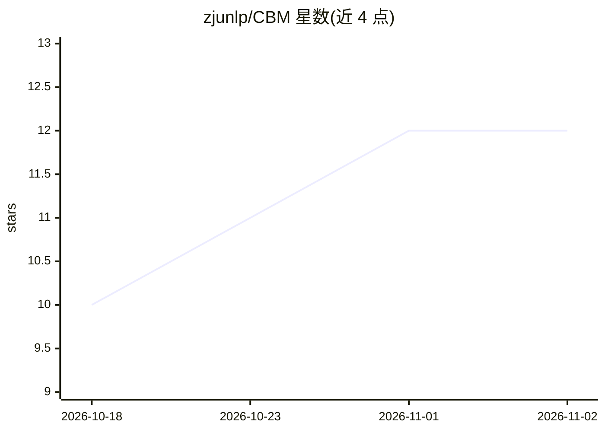

# zjunlp/CBM

⭐ 12 · Python · 推送 2026-05-30 · [GitHub](https://github.com/zjunlp/CBM) · 组织维护 · 中文 README

**论文官方实现：LLM 上下文信念管理的训练与评测框架**

EMNLP 2026 论文《When Should Models Change Their Minds? Contextual Belief Management in Large Language Models》的官方代码库，由 zjunlp 团队维护。提供 Task A（Rule Discovery）与 Task B（Circuit Diagnosis）两个环境的 GRPO 多轮在线训练脚本、基于 vllm 的评测流程（failed_stay/failed_update/failed_isolation 三类失败率），以及深度与噪声分析、belief probing、activation steering（依赖 EasySteer 独立安装）三个分析工作流。训练数据 BeliefTrackDataset 从 HuggingFace 下载，默认针对 Qwen3.5-7B/9B 模型，需多 GPU 环境。

## 筛选速览

| 维度 | 判定 | 备注 |
|---|---|---|
| AI 角色 | `ai-ecosystem` | LLM/agent 周边工具 |
| 许可风险 | `none` | — |
| 部署形态 | `None` |  |
| 模型依赖 | local-ok | 支持本地模型 |
| 硬件要求 | — | 无带数字的原话,不猜 |
| 安装摩擦 | `medium` | 含编译或系统依赖之一 |
| 成熟度 | — | 结构信号不足 |

## 能力要点

- Task A/B 两环境的多轮在线 GRPO 训练脚本
- 三类信念失败（failed_stay/update/isolation）评测与统计报告
- 深度与噪声、probing、activation steering 三套分析工作流
- BeliefTrackDataset 数据集经 HuggingFace CLI 下载

## 适用场景

- 复现论文的信念管理训练与评测结果
- 在自有模型上测量三类信念失败率
- 对模型内部信念表征做 probing 与 steering 分析

## 场景标签

`强化学习` `模型评测` `科研工具` · 领域:评测与运维

## 证据(README 行号)

> L7: This repository provides the official implementation of our paper:
> L54: ## Training
> L78: ## Evaluation

## 星数曲线

2026-10-18 10 → 2026-11-02 12（+2）

---
*卡片 v1 · prompt 1.4 · 生成 2026-10-31 · 置信度 high · 依据 README sha `ddce4c8e2cc6` · [字段定义](../../DATASET.md)*
