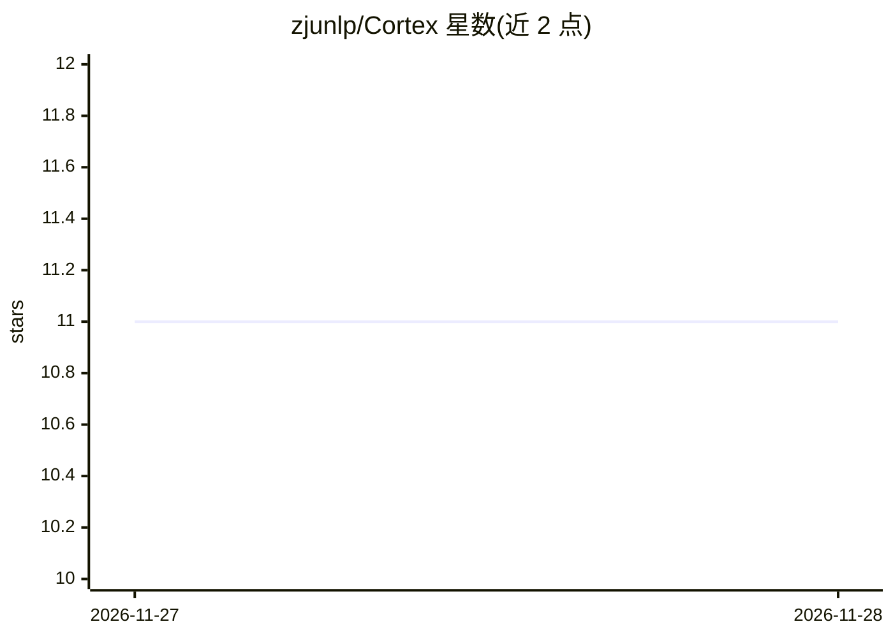

# zjunlp/Cortex

⭐ 11 · Python · MIT · 推送 2026-11-26 · [GitHub](https://github.com/zjunlp/Cortex) · 组织维护 · 中文 README

**将上下文巩固进模型参数的记忆训练研究框架**

Cortex（Python 包名 mc）提供把知识、指令或 agent 经验从上下文转化为模型参数的完整流程：生成问答监督或采集 agent rollout，用交叉熵、logit 蒸馏或隐状态匹配训练 LoRA 等适配器，并通过统一的 evaluate() 接口同时评估已学能力与保留能力。支持批量经验与持续巩固（复用或冻结旧适配器）。面向研究人员，附带 ZsRE、Code、ALFWorld、Tau2 等经验数据与 MMLU、GSM8K 等评测任务，需自备模型后端与 OpenAI 兼容裁判服务。

## 筛选速览

| 维度 | 判定 | 备注 |
|---|---|---|
| AI 角色 | `ai-native` | 本体是模型或模型工具 |
| 许可风险 | `permissive` | MIT |
| 部署形态 | `None` |  |
| 模型依赖 | — | README 未给出锁定关系 |
| 硬件要求 | — | 无带数字的原话,不猜 |
| 安装摩擦 | `medium` | 含编译或系统依赖之一 |
| 成熟度 | — | 结构信号不足 |

## 能力要点

- 生成监督→巩固训练→学习/保留双评估的三步工作流
- 支持交叉熵、logit 蒸馏、隐状态匹配三种训练方式
- reuse_adapter 与冻结旧适配器两种持续巩固模式
- 内置多领域经验数据与共享评测任务集

## 适用场景

- 做知识编辑与参数化记忆的研究实验
- 持续学习场景下衡量新能力学习与旧能力保留
- 将 agent 经验数据巩固进模型参数

## 场景标签

`微调` `模型评测` `Agent 记忆` · 领域:Agent 开发

## 证据(README 行号)

> L9: Cortex turns context into model memory. It generates supervision from knowledge, instructions, or agent experience, 
> L11: The Python package, **`mc`**, connects experience data, consolidation methods, model backends, and evaluators throu
> L22: 2. **Consolidate the context.** Cortex generates questions and answers or collects agent rollouts, then trains an a

## 星数曲线

2026-11-27 11 → 2026-11-28 11（+0）

---
*卡片 v1 · prompt 1.4 · 生成 2026-11-27 · 置信度 high · 依据 README sha `7dc38855106a` · [字段定义](../../DATASET.md)*
