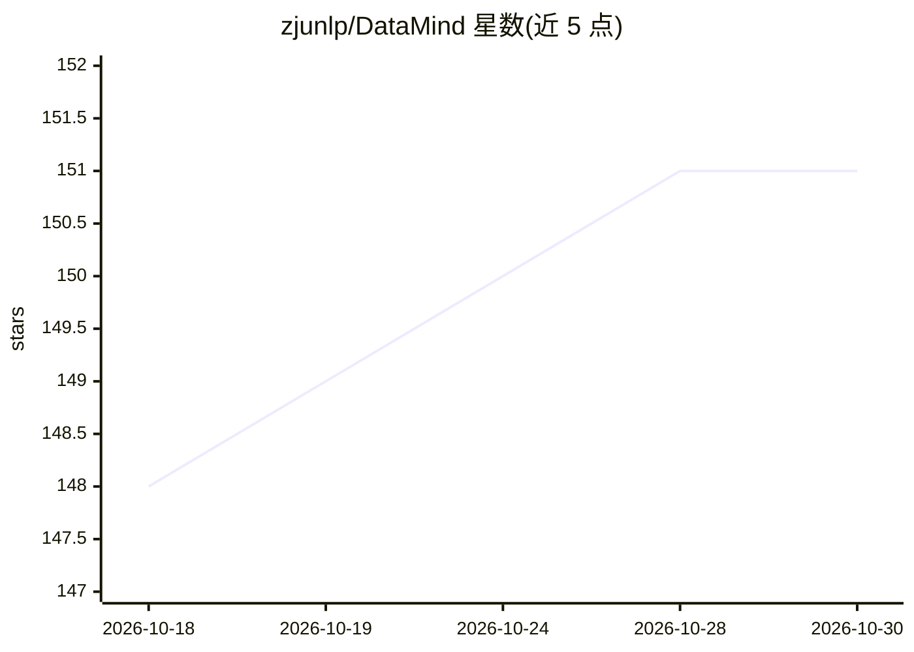

# zjunlp/DataMind

⭐ 151 · Python · 推送 2026-09-29 · [GitHub](https://github.com/zjunlp/DataMind) · [官网](https://zjunlp.github.io/DataMind/) · 组织维护 · 中文 README

**面向研究者：开源 LLM 数据分析 agent 的多项目研究合集**

由 zjunlp（浙江大学团队）维护的研究型仓库，聚合多个 LLM 数据分析 agent 相关项目：开源 LLM 数据分析能力的实证诊断（AAAI 2026）、通用数据分析 agent 的可扩展数据合成与训练配方（ICLR 2026）、环境感知的过程奖励模型 DataPRM（KDD 2026）、长程多轮数据分析评测基准 LongDS-Bench（EMNLP 2026）、无监督验证器引导的技能发现框架 DataCOPE（arXiv）。各项目以子文档形式组织并附论文链接，README 主体为项目导航与论文列表，具体安装运行方式在各子项目文档中。

## 筛选速览

| 维度 | 判定 | 备注 |
|---|---|---|
| AI 角色 | `ai-knowledge` | 知识聚合/清单类 |
| 许可风险 | `none` | — |
| 部署形态 | `None` |  |
| 模型依赖 | — | README 未给出锁定关系 |
| 硬件要求 | — | 无带数字的原话,不猜 |
| 安装摩擦 | `low` | 无编译、无系统依赖或容器化 |
| 成熟度 | — | 结构信号不足 |

## 能力要点

- 收录 5 个子项目，均配套论文（AAAI/ICLR/KDD/EMNLP 2026 等）
- 覆盖训练配方、过程奖励模型、长程评测基准、技能发现框架
- 提供在 Claude Code 与 Codex 中使用数据分析技能的教程与技能生成框架

## 适用场景

- 跟进 LLM 数据分析 agent 的研究进展与论文
- 查找数据分析 agent 的训练数据合成与训练方法
- 使用 LongDS-Bench 评测多轮长程数据分析能力

## 场景标签

`数据分析` `模型评测` `精选清单` · 领域:效率与自动化

## 证据(README 行号)

> L38: ## 🧭 Project Navigation
> L39: This repository hosts multiple data analysis projects. The table below provides an overview and links to each proje
> L41: |Project|Description|Paper|Documentation|

## 星数曲线

2026-10-18 148 → 2026-10-30 151（+3）

---
*卡片 v1 · prompt 1.4 · 生成 2026-10-22 · 置信度 mid · 依据 README sha `1d717d782682` · [字段定义](../../DATASET.md)*
