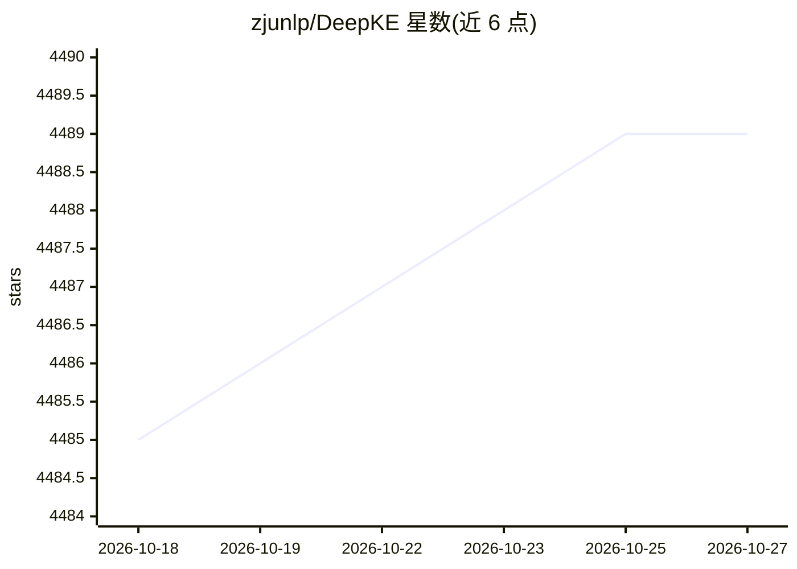

# zjunlp/DeepKE

⭐ 4,489 · Python · MIT · 推送 2026-07-13 · [GitHub](https://github.com/zjunlp/DeepKE) · [官网](http://deepke.zjukg.cn/) · 组织维护 · 中文 README

**面向知识图谱构建的知识抽取开源工具包**

浙江大学 zjunlp 团队维护的深度学习知识抽取工具包（EMNLP 2022 论文），覆盖命名实体识别、关系抽取、属性抽取三项任务，支持 cnSchema、低资源（few-shot）、文档级、多模态场景。统一框架下每个场景由 Data、Model、Core 三部分组成；提供 DeepKE-cnSchema 免训练成品模型、LLM 版本（DeepKE-LLM/OneKE）与 MCP 工具服务。以 pip、源码或 Docker 安装，推荐 Linux，pip 安装方式官方标注不推荐。

## 筛选速览

| 维度 | 判定 | 备注 |
|---|---|---|
| AI 角色 | `ai-native` | 本体是模型或模型工具 |
| 许可风险 | `permissive` | MIT |
| 部署形态 | `self-host` | docker 或自建部署 |
| 模型依赖 | — | README 未给出锁定关系 |
| 硬件要求 | — | 无带数字的原话,不猜 |
| 安装摩擦 | `low` | 无编译、无系统依赖或容器化 |
| 成熟度 | — | 结构信号不足 |

## 能力要点

- 统一框架支持实体/关系/属性三类知识抽取
- 覆盖全监督、few-shot、文档级、多模态四种设定
- 提供 DeepKE-cnSchema 免训练成品模型（NER/RE）
- 集成 MCP 服务工具，以 LLM 作为调用方驱动轻量模型做知识抽取

## 适用场景

- 从非结构化文本抽取实体和关系构建知识图谱
- 低资源/小样本场景下训练信息抽取模型
- 通过 cnSchema 成品模型免训练直接抽取中文实体与关系

## 场景标签

`知识图谱` · 领域:知识与检索

## 证据(README 行号)

> L21: DeepKE is a knowledge extraction toolkit for knowledge graph construction supporting **cnSchema**，**low-resource**,
> L40: - DeepKE contains a unified framework for **named entity recognition**, **relation extraction** and **attribute ext

## 星数曲线

2026-10-18 4,485 → 2026-10-27 4,489（+4）

---
*卡片 v1 · prompt 1.4 · 生成 2026-10-20 · 置信度 high · 依据 README sha `5457758fe027` · [字段定义](../../DATASET.md)*
