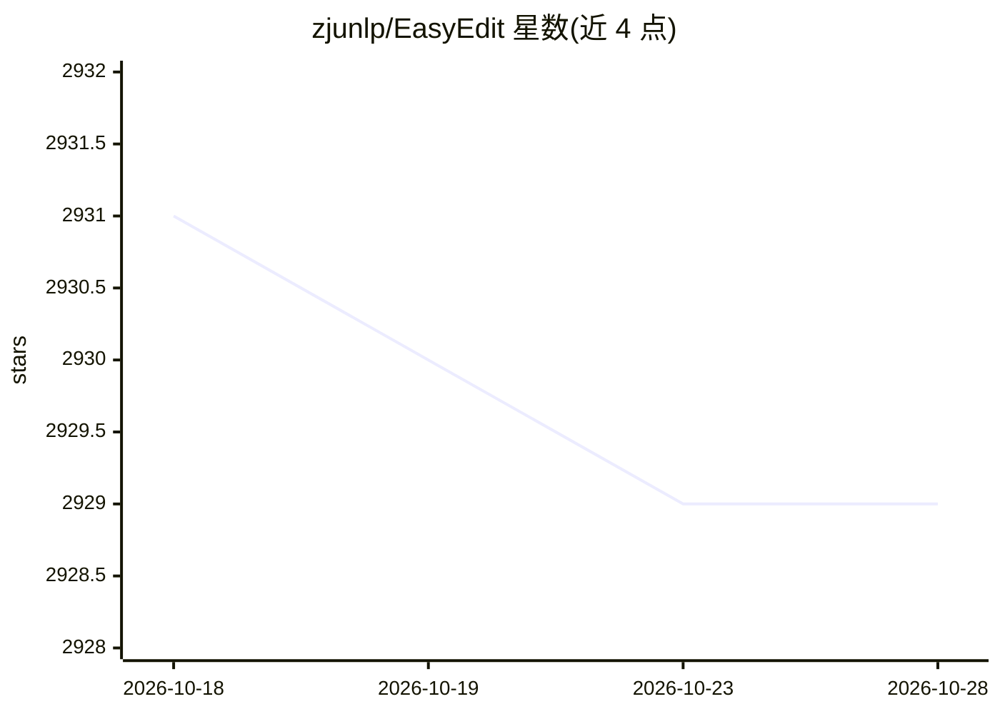

# zjunlp/EasyEdit

⭐ 2,929 · Jupyter Notebook · MIT · 推送 2026-10-04 · [GitHub](https://github.com/zjunlp/EasyEdit) · [官网](https://zjunlp.github.io/project/KnowEdit) · 组织维护 · 中文 README

**面向研究者的 LLM 知识编辑与推理时引导框架**

ACL 2024 系统演示论文对应的开源框架（zjunlp，浙大团队）。EasyEdit 1.0 通过修改或引入参数实现模型知识编辑，集成 ROME/MEMIT/WISE/AlphaEdit/GRACE 等大量方法，支持 Llama、Mistral、Baichuan2、ChatGLM2、Qwen 等模型；EasyEdit 2.0 转向无需重训的推理时实时引导（steering），统一多种引导方法并支持评测。还提供多模态编辑器、KnowEdit 等数据集与 Jupyter Notebook 演示，多 GPU 编辑基于 Accelerate。以研究/工程工具形式服务 LLM 知识编辑方向的研究者与开发者。

## 筛选速览

| 维度 | 判定 | 备注 |
|---|---|---|
| AI 角色 | `ai-ecosystem` | LLM/agent 周边工具 |
| 许可风险 | `permissive` | MIT |
| 部署形态 | `library` | 以包/库形式分发 |
| 模型依赖 | local-ok | 支持本地模型 |
| 硬件要求 | — | 无带数字的原话,不猜 |
| 安装摩擦 | `medium` | 含编译或系统依赖之一 |
| 成熟度 | — | 结构信号不足 |

## 能力要点

- 集成 ROME/MEMIT/WISE/AlphaEdit/GRACE 等多种知识编辑算法
- EasyEdit2 提供无需重训的推理时引导统一框架
- 支持多 GPU 编辑（基于 Accelerate）与多模态模型编辑
- 配套 KnowEdit/CKnowEdit 等数据集与评测方法

## 适用场景

- 对已部署 LLM 修正过时或错误的事实知识
- 研究并对比各类知识编辑/引导算法的效果
- 通过推理时引导控制 LLM 行为（如缓解幻觉）

## 场景标签

 · 领域:LLM 知识编辑/模型可控性

## 证据(README 行号)

> L27:  Unlike EasyEdit1.0, which achieves knowledge editing by updating internal parameters or introducing additional par
> L95: - 2023-8-15, we release the paper "EasyEdit: An Easy-to-use Knowledge Editing Framework for Large Language Models."

## 星数曲线

2026-10-18 2,931 → 2026-10-28 2,929（-2）

---
*卡片 v1 · prompt 1.4 · 生成 2026-10-21 · 置信度 high · 依据 README sha `d498da80527b` · [字段定义](../../DATASET.md)*
