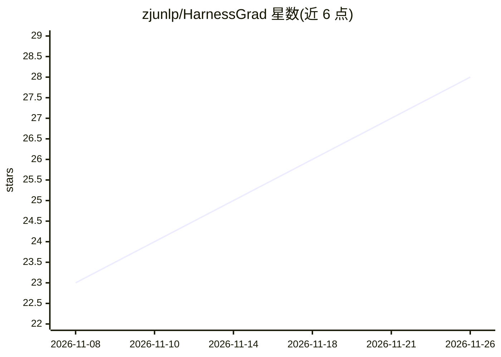

# zjunlp/HarnessGrad

⭐ 28 · Python · MIT · 推送 2026-11-25 · [GitHub](https://github.com/zjunlp/HarnessGrad) · [官网](https://zjunlp.github.io/HarnessGrad/) · 组织维护 · 中文 README

**运行与比较 agent harness 自我改进方法的实验平台**

HarnessGrad 将一次实验定义为 harness × 方法 × benchmark 的组合：harness 执行任务，方法在轮次间对 harness 提出编辑，benchmark 对候选打分；平台提供任务分发与评分、隔离执行（bubblewrap 沙箱）、候选 harness 版本控制与实验曲线记录。内置 8 个 harness、19 个 RSI 方法、56 个 benchmark 适配器，支持自带 harness/方法/基准。平台本体仅依赖 Python 标准库，需 Linux、Python 3.12+、git、uv 与 bubblewrap。面向研究自我改进（RSI）方法的科研用户。

## 筛选速览

| 维度 | 判定 | 备注 |
|---|---|---|
| AI 角色 | `ai-ecosystem` | LLM/agent 周边工具 |
| 许可风险 | `permissive` | MIT |
| 部署形态 | `library` | 以包/库形式分发 |
| 模型依赖 | — | README 未给出锁定关系 |
| 硬件要求 | — | 无带数字的原话,不猜 |
| 安装摩擦 | `low` | 无编译、无系统依赖或容器化 |
| 成熟度 | — | 结构信号不足 |

## 能力要点

- harness × 方法 × benchmark 三维实验空间，一次命令运行
- 内置 8 个 harness、19 个 RSI 方法、56 个 benchmark 适配器
- 沙箱隔离执行、候选 harness 版本控制与测量凭证记录
- 平台本体无第三方运行时依赖，仅用标准库

## 适用场景

- 运行并比较不同 harness 自我改进方法在同一基准上的表现
- 自带 harness、方法或 benchmark 适配器开展 RSI 实验
- 通过 Console 检查实验、harness 版本与任务轨迹

## 场景标签

`模型评测` `科研工具` · 领域:评测与运维

## 证据(README 行号)

> L17: A run is one point in a **harness × method × benchmark** space: a *harness* solves tasks, a
> L19: candidate. HarnessGrad provides tasks and scoring, isolated execution, and version control
> L30: |**benchmarks**|56 declared adapters; preparation and runtime prerequisites vary — every one listed: `agentdojo`, `

## 星数曲线

2026-11-08 23 → 2026-11-26 28（+5）

---
*卡片 v1 · prompt 1.4 · 生成 2026-11-18 · 置信度 high · 依据 README sha `a26cab6d665c` · [字段定义](../../DATASET.md)*
