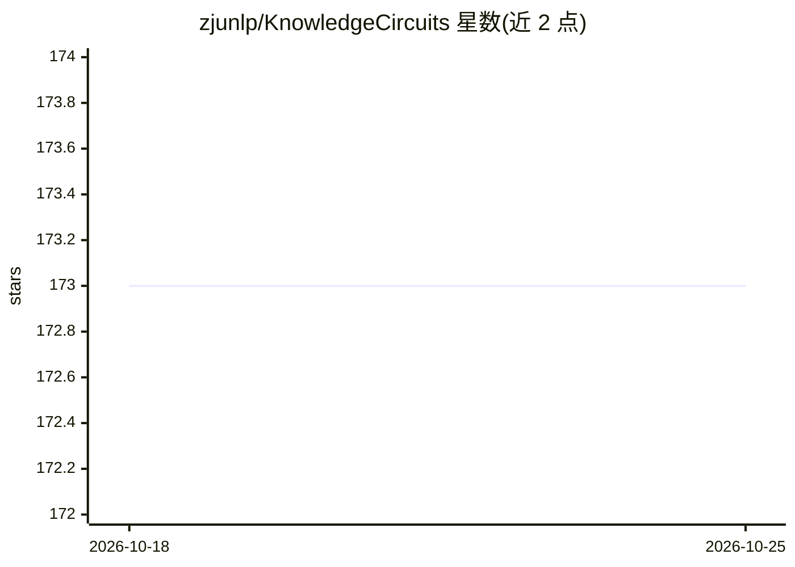

# zjunlp/KnowledgeCircuits

⭐ 173 · Python · MIT · 推送 2025-11-14 · [GitHub](https://github.com/zjunlp/KnowledgeCircuits) · [官网](https://zjunlp.github.io/project/knowledgecircuits) · 组织维护

**面向研究者的 LLM 知识回路发现与分析代码库**

NeurIPS 2024 论文 Knowledge Circuits in Pretrained Transformers 的官方代码：在预训练语言模型（如 GPT2-Medium、LLaMA2-7B-Chat）中定位承载特定知识的功能回路（knowledge circuits），分析其中组件的行为。提供 ACDC 与 EAP-IG 两种回路构建方法，EAP-IG 在单卡上运行 LLaMA2-7B-Chat 约需 57GB 显存、3-4 分钟。代码基于 transformer_lens、ACDC 与 LRE 三个项目构建，需下载过滤后的数据集配合使用，建议 torch 1.x 环境。附带 Demo 与论文、后续持续预训练研究。

## 筛选速览

| 维度 | 判定 | 备注 |
|---|---|---|
| AI 角色 | `ai-ecosystem` | LLM/agent 周边工具 |
| 许可风险 | `permissive` | MIT |
| 部署形态 | `library` | 以包/库形式分发 |
| 模型依赖 | — | README 未给出锁定关系 |
| 硬件要求 | — | 无带数字的原话,不猜 |
| 安装摩擦 | `low` | 无编译、无系统依赖或容器化 |
| 成熟度 | — | 结构信号不足 |

## 能力要点

- ACDC 与更快的 EAP-IG 两种知识回路构建方法
- 按知识类型（如 country_capital_city）定位模型内回路并输出 final_graph.pdf
- 提供组件级分析 notebook（component.ipynb）
- NeurIPS 2024 论文官方实现，附带 Demo 与视频讲解

## 适用场景

- 研究预训练 Transformer 中特定知识的存储回路
- 分析知识编辑与模型幻觉相关的内部组件
- 跟踪持续预训练过程中知识回路的演化（新论文）

## 场景标签

 · 领域:NLP/模型可解释性研究

## 证据(README 行号)

> L22: This work aims to build the circuits in the pretrained language models that are responsible for the specific knowle
> L24: * A new method EAP-IG is integrated in the eap folder. This method takes less time than the ACDC method and you can

## 星数曲线

2026-10-18 173 → 2026-10-25 173（+0）

---
*卡片 v1 · prompt 1.4 · 生成 2026-10-22 · 置信度 mid · 依据 README sha `ae1d9aec7e30` · [字段定义](../../DATASET.md)*
