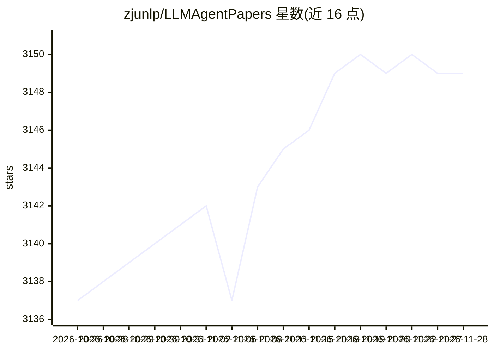

# zjunlp/LLMAgentPapers

⭐ 3,149 · 推送 2026-11-17 · [GitHub](https://github.com/zjunlp/LLMAgentPapers) · 组织维护

**面向研究者的 LLM Agent 论文清单（按人格/记忆/规划等分类）**

zjunlp 维护的论文聚合清单，收录大语言模型 Agent 相关必读论文，按 Overview、Personality、Memory、Planning 等主题分类组织，每条含标题、作者、arXiv 链接与时间；以 MIT 许可发布，附带同团队的推理、知识编辑等其他论文清单链接。仓库自 2023-06 起维护，持续更新并发布相关论文（如 KnowAgent）。

## 筛选速览

| 维度 | 判定 | 备注 |
|---|---|---|
| AI 角色 | `ai-knowledge` | 知识聚合/清单类 |
| 许可风险 | `permissive` | — |
| 部署形态 | `None` |  |
| 模型依赖 | — | README 未给出锁定关系 |
| 硬件要求 | — | 无带数字的原话,不猜 |
| 安装摩擦 | `low` | 无编译、无系统依赖或容器化 |
| 成熟度 | — | 结构信号不足 |

## 能力要点

- 按 Personality/Memory/Planning 等主题分类组织论文条目
- 每条含作者列表与 arXiv 链接
- 附带同系列论文清单（推理、知识编辑等）
- MIT 许可，持续更新

## 适用场景

- 快速了解 LLM Agent 研究方向与代表论文
- 为综述或课题调研收集文献线索
- 跟踪 Multi-agents 领域新收录论文

## 场景标签

`科研工具` `精选清单` · 领域:学习与行业

## 证据(README 行号)

> L6: Must-read Papers on Large Language Model Agents.
> L25: ## 🌄 Papers
> L27: ### Overview

## 星数曲线

2026-10-26 3,137 → 2026-11-28 3,149（+12）

---
*卡片 v1 · prompt 1.4 · 生成 2026-11-23 · 置信度 high · 依据 README sha `c4b24b0a8d8d` · [字段定义](../../DATASET.md)*
