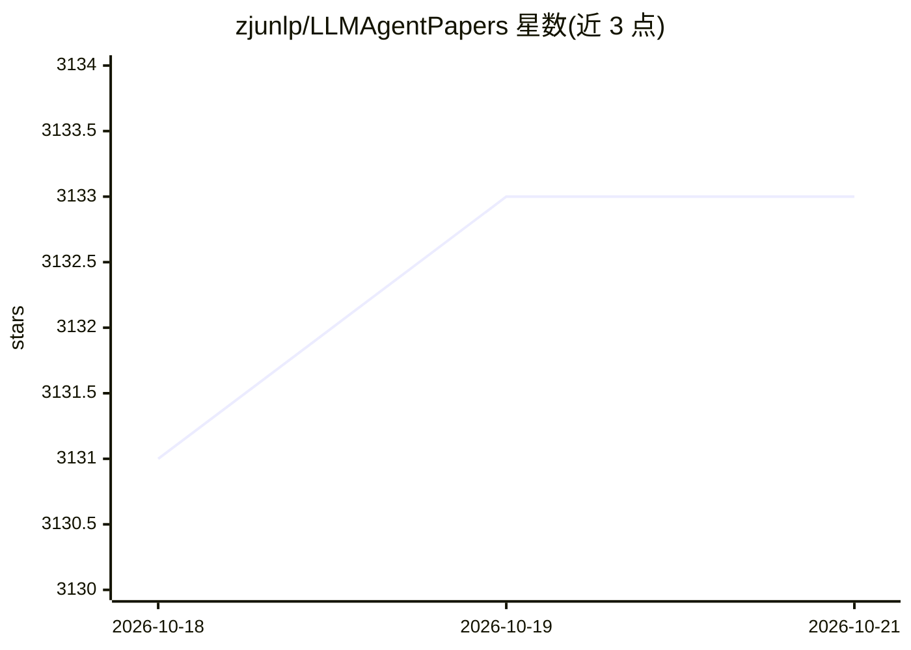

# zjunlp/LLMAgentPapers

⭐ 3,136 · 推送 2026-10-20 · [GitHub](https://github.com/zjunlp/LLMAgentPapers) · 组织维护

**LLM Agent 领域必读论文清单：按主题分类收录**

由 zjunlp 维护的 LLM Agent 论文精选清单，按 Overview、Agent（人格、记忆、规划等）、多智能体等主题分类组织，条目含标题、作者与 arXiv 链接，创建于 2023-06，持续更新至 2025-2026 年的 survey 与论文。面向从事 LLM Agent 研究的科研人员与开发者，用于文献调研与跟踪领域进展。仓库本身不含代码或可运行组件，仅提供 MIT 许可的论文列表与相关清单链接（如 Prompt4ReasoningPapers、KnowledgeEditingPapers）。

## 筛选速览

| 维度 | 判定 | 备注 |
|---|---|---|
| AI 角色 | `ai-knowledge` | 知识聚合/清单类 |
| 许可风险 | `permissive` | — |
| 部署形态 | `None` |  |
| 模型依赖 | — | README 未给出锁定关系 |
| 硬件要求 | — | 无带数字的原话,不猜 |
| 安装摩擦 | `low` | 无编译、无系统依赖或容器化 |
| 成熟度 | — | 结构信号不足 |

## 能力要点

- 按 Overview/人格/记忆/规划等主题分类组织论文条目
- 条目含作者列表与 arXiv 链接
- 链接同团队的 Prompt4ReasoningPapers、KnowledgeEditingPapers 清单

## 适用场景

- 系统性调研 LLM Agent 领域的经典与最新论文
- 按记忆、规划、人格等子主题查找特定方向文献
- 跟踪该领域 survey 与新论文的更新动态

## 场景标签

`精选清单` `科研工具` · 领域:学习与行业

## 证据(README 行号)

> L6: Must-read Papers on Large Language Model Agents.
> L25: ## 🌄 Papers

## 星数曲线

2026-10-18 3,131 → 2026-10-21 3,133（+2）

---
*卡片 v1 · prompt 1.4 · 生成 2026-10-20 · 置信度 high · 依据 README sha `5fb746bf0637` · [字段定义](../../DATASET.md)*
