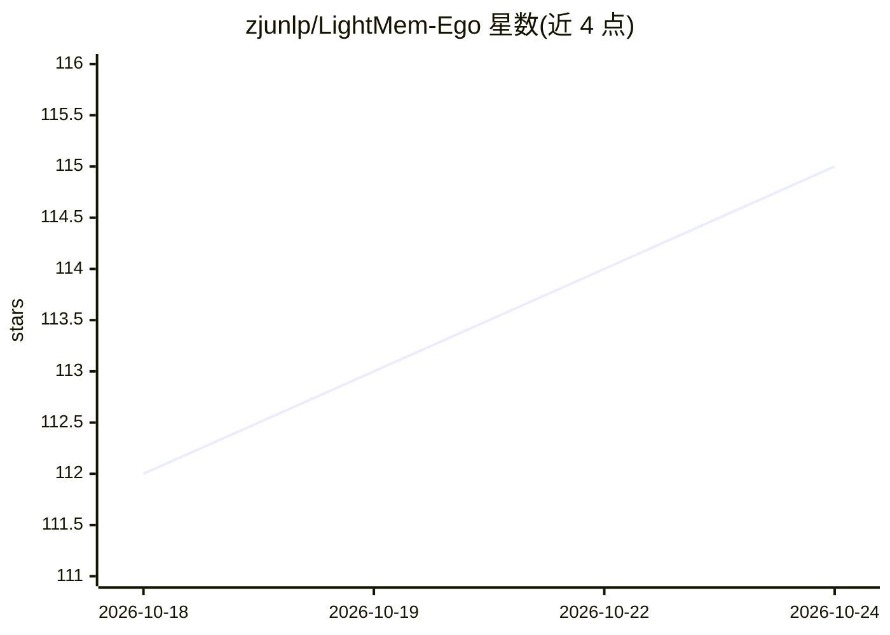

# zjunlp/LightMem-Ego

⭐ 115 · Python · MIT · 推送 2026-10-05 · [GitHub](https://github.com/zjunlp/LightMem-Ego) · [官网](https://lightmem-ego.zjukg.cn/) · 组织维护 · 中文 README

**面向智能眼镜与手机的自我中心多模态 AI 记忆系统**

开源、可自托管的多模态记忆系统：从 Rokid AI 眼镜或手机持续采集第一视角视频帧与音频，按对齐时间线组织为三层记忆（当前场景 M_cur、短期微事件 M_st、长期事件记忆 M_lt），长期层由 EM²Mem 引擎（EMNLP 2026 Findings）以事件为检索单元构建情景与语义图。用户可在眼镜 HUD 或网页同一会话中提问，回答附带时间戳的视觉与转录证据。标准部署为 docker compose 自托管，需外部 OpenAI 兼容 LLM 端点与讯飞 ASR 凭证；视觉检索与本地 Qwen（vLLM）为可选附加，需 GPU。评测基于 27 个查询的小规模原型数据集，测量结果而非公开榜单。

## 筛选速览

| 维度 | 判定 | 备注 |
|---|---|---|
| AI 角色 | `ai-native` | 本体是模型或模型工具 |
| 许可风险 | `permissive` | MIT |
| 部署形态 | `self-host` | docker 或自建部署 |
| 模型依赖 | local-ok | 支持本地模型 |
| 硬件要求 | — | 无带数字的原话,不猜 |
| 安装摩擦 | `low` | 无编译、无系统依赖或容器化 |
| 成熟度 | — | 结构信号不足 |

## 能力要点

- 眼镜/手机第一视角流式采集与统一会话时间线（帧、音频、ASR 转录）
- 三层记忆架构：M_cur / M_st / M_lt，长期层由 EM²Mem 事件中心记忆引擎驱动
- 回答附带时间戳视觉与转录证据（memory-grounded answers）
- docker compose 一键自托管全栈，眼镜端提供 APK

## 适用场景

- 戴着眼镜问『我的工牌放哪了』，找回看过位置的带证据回答
- 回溯当天对话与行程，生成生活摘要
- 长期积累后询问习惯性日常与偏好
- 无眼镜时用手机浏览器摄像头/麦克风体验完整流程

## 场景标签

 · 领域:多模态 AI 记忆/可穿戴计算

## 证据(README 行号)

> L68: - 🎥 **Always-on egocentric capture** — streams first-person camera frames and microphone audio from Rokid AI Glasse
> L71: - 🔍 **Memory-grounded answers** — every answer ships with the timestamped visual and transcript evidence behind it.
> L207:                   ├─► Stream API ─► M_cur ─► M_st ─► M_lt ─► Retrieval ─► Answer + Evidence

## 星数曲线

2026-10-18 112 → 2026-10-24 115（+3）

---
*卡片 v1 · prompt 1.4 · 生成 2026-10-23 · 置信度 high · 依据 README sha `beb3155315b0` · [字段定义](../../DATASET.md)*
