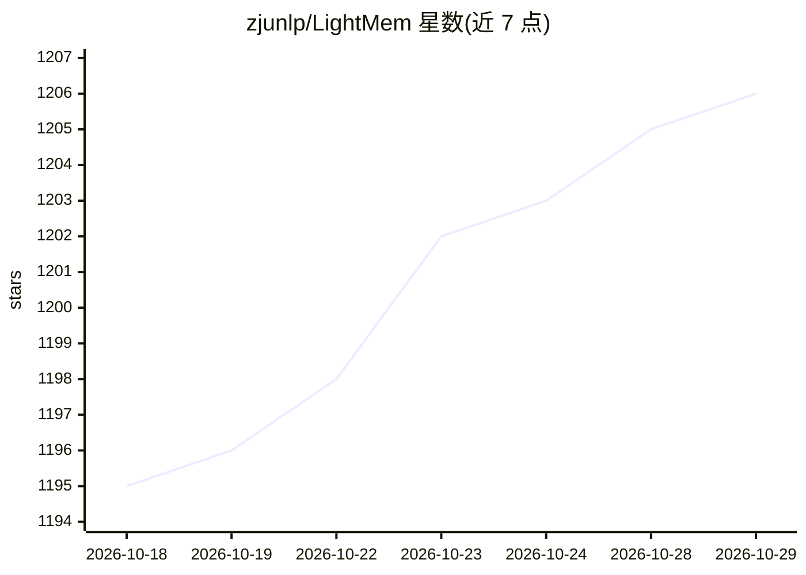

# zjunlp/LightMem

⭐ 1,206 · Python · MIT · 推送 2026-10-26 · [GitHub](https://github.com/zjunlp/LightMem) · 组织维护 · 中文 README

**面向 LLM 与 Agent 的轻量级长期记忆管理框架**

为 LLM 和 AI Agent 提供记忆存储、检索与更新的模块化框架，ICLR 2026 论文（arXiv:2510.18866）。核心流程包含预压缩（llmlingua-2/entropy_compress）、话题分割、记忆管理与检索（Qdrant/FAISS/BM25），支持 OpenAI/DeepSeek 云 API 与 Ollama/vLLM/Transformers 本地部署。仓库同时收录 FluxMem、EM²Mem、StructMem 等多个记忆方法，提供 LoCoMo/LongMemEval 复现脚本、基线评测框架、教程 Notebook 与 MCP Server。安装目前以源码为主，pip 标注 Coming soon。

## 筛选速览

| 维度 | 判定 | 备注 |
|---|---|---|
| AI 角色 | `ai-ecosystem` | LLM/agent 周边工具 |
| 许可风险 | `permissive` | MIT |
| 部署形态 | `library` | 以包/库形式分发 |
| 模型依赖 | local-ok | 支持本地模型 |
| 硬件要求 | — | 无带数字的原话,不猜 |
| 安装摩擦 | `low` | 无编译、无系统依赖或容器化 |
| 成熟度 | — | 结构信号不足 |

## 能力要点

- 预压缩+话题分割+记忆管理+检索的模块化可插拔管线
- 支持 OpenAI/DeepSeek 云 API 与 Ollama/vLLM/Transformers 本地部署
- 提供 LoCoMo/LongMemEval 复现脚本与多记忆层基线评测框架
- 提供 MCP Server 支持客户端调用

## 适用场景

- 为对话 Agent 或 Chatbot 增加长期记忆能力
- 在 LoCoMo/LongMemEval 基准上评测记忆层方法
- 通过 MCP 客户端调用记忆工具

## 场景标签

`Agent 记忆` · 领域:Agent 开发

## 证据(README 行号)

> L17: **LightMem** is a lightweight and efficient memory management framework designed for Large Language Models and AI A
> L160: |`MemoryManagerConfig`|`openai`, `deepseek`, `ollama`, `vllm`, etc.|

## 星数曲线

2026-10-18 1,195 → 2026-10-29 1,206（+11）

---
*卡片 v1 · prompt 1.4 · 生成 2026-10-21 · 置信度 mid · 依据 README sha `6e950244346e` · [字段定义](../../DATASET.md)*
