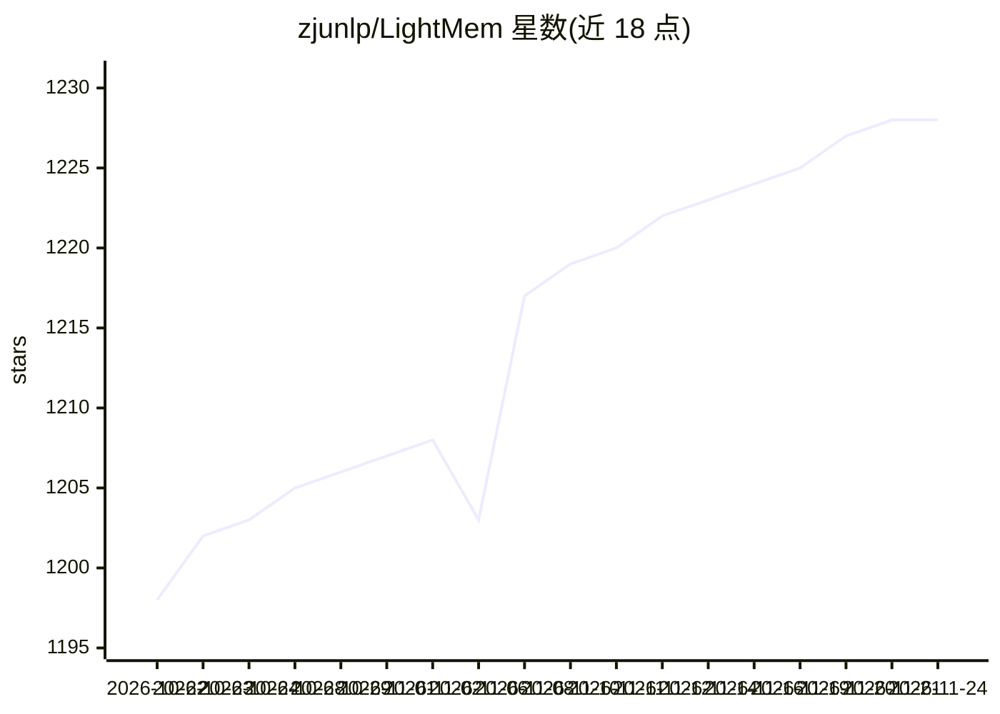

# zjunlp/LightMem

⭐ 1,230 · Python · MIT · 推送 2026-11-17 · [GitHub](https://github.com/zjunlp/LightMem) · 组织维护

**为 LLM 与 AI Agent 提供长期记忆的轻量管理框架**

面向大语言模型与 AI Agent 的记忆管理框架，提供记忆的存储、检索与更新机制，支持构建带长期记忆能力的应用。采用模块化架构，各组件可插拔替换：预压缩、主题分段、记忆管理、嵌入、检索各模块均支持多种后端（如 llmlingua-2、Qdrant、FAISS、BM25）。提供 LoCoMo 与 LongMemEval 数据集的复现脚本及基线评测框架，并附带 MCP Server、示例 Notebook 与实验结果。安装方式为源码克隆或 pip（标注即将提供）。

## 筛选速览

| 维度 | 判定 | 备注 |
|---|---|---|
| AI 角色 | `ai-ecosystem` | LLM/agent 周边工具 |
| 许可风险 | `permissive` | MIT |
| 部署形态 | `library` | 以包/库形式分发 |
| 模型依赖 | local-ok | 支持本地模型 |
| 硬件要求 | — | 无带数字的原话,不猜 |
| 安装摩擦 | `low` | 无编译、无系统依赖或容器化 |
| 成熟度 | — | 结构信号不足 |

## 能力要点

- 模块化设计，各组件支持可插拔后端（llmlingua-2/Qdrant/FAISS/BM25 等）
- 支持云端 API（OpenAI、DeepSeek）与本地模型（Ollama、vLLM、Transformers）
- 提供 LoCoMo/LongMemEval 复现脚本与 Mem0、A-MEM 等基线评测框架
- 提供 MCP Server 与多场景 Tutorial Notebook（旅行规划、代码助手）

## 适用场景

- 给聊天机器人或 Agent 增加长期记忆能力
- 在 LoCoMo/LongMemEval 上评测与对比记忆层方案
- 通过 MCP Server 让本地客户端调用记忆管理工具

## 场景标签

`Agent 记忆` `模型评测` · 领域:Agent 开发

## 证据(README 行号)

> L17: **LightMem** is a lightweight and efficient memory management framework designed for Large Language Models and AI A
> L160: |`MemoryManagerConfig`|`openai`, `deepseek`, `ollama`, `vllm`, etc.|

## 星数曲线

2026-10-22 1,198 → 2026-11-24 1,228（+30）

---
*卡片 v1 · prompt 1.4 · 生成 2026-11-23 · 置信度 high · 依据 README sha `becf66560853` · [字段定义](../../DATASET.md)*
