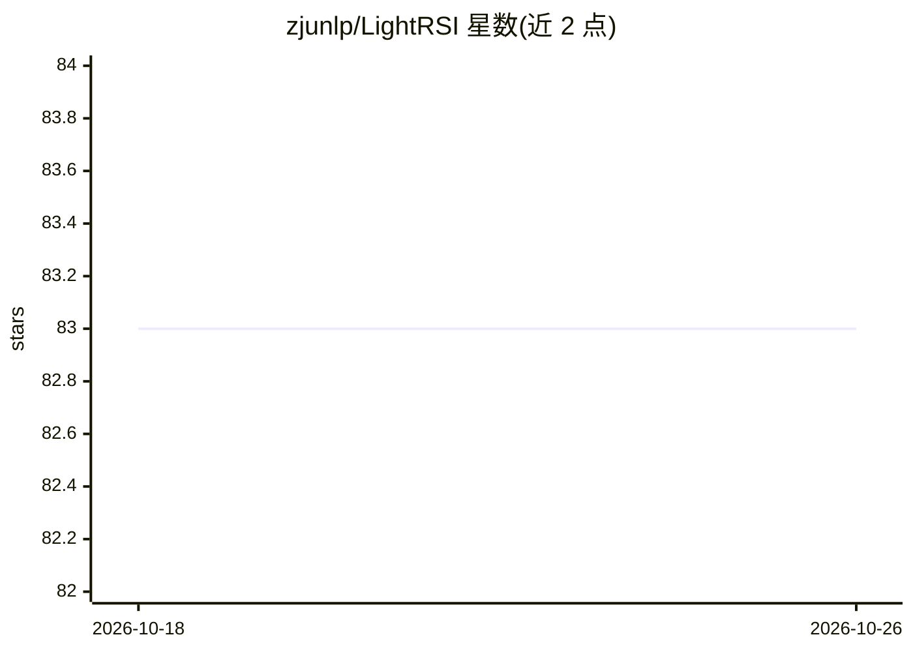

# zjunlp/LightRSI

⭐ 83 · TypeScript · MIT · 推送 2026-10-03 · [GitHub](https://github.com/zjunlp/LightRSI) · [官网](https://zjunlp.github.io/LightRSI/) · 组织维护 · 中文 README

**长程 LLM agent 的递归自改进运行时框架**

面向长时间运行的编码 agent（OpenClaw、Codex CLI、Claude Code、OpenCode、pi、DeepSeek Harness）的模块化运行时，提供两个产品：TokenPilot 通过稳定可复用前缀、裁剪过大工具输出、限制历史上下文携带来降低 token 用量与成本；Context Cleaner 在多 host 上提供一致的任务分析、批准、状态与取消模型，分析只读且需确认后生效。安装为 git clone 后以 pnpm/npm 构建，按 host 选择不同安装入口（插件/hooks/本地代理/MCP），EMNLP 2026 论文 TokenPilot 随附。

## 筛选速览

| 维度 | 判定 | 备注 |
|---|---|---|
| AI 角色 | `ai-ecosystem` | LLM/agent 周边工具 |
| 许可风险 | `permissive` | MIT |
| 部署形态 | `library` | 以包/库形式分发 |
| 模型依赖 | — | README 未给出锁定关系 |
| 硬件要求 | — | 无带数字的原话,不猜 |
| 安装摩擦 | `low` | 无编译、无系统依赖或容器化 |
| 成熟度 | — | 结构信号不足 |

## 能力要点

- TokenPilot 缓存高效上下文管理（稳定前缀/裁剪工具输出/限制历史携带）
- Context Cleaner 覆盖 OpenClaw/Codex/Claude Code/DeepSeek Harness，分析只读、需确认后生效
- 六种 host 各有适配安装入口（插件/hooks/本地代理/进程内插件/MCP）
- conservative/normal/aggressive 三档预设模式与 doctor/report/visual CLI 诊断命令

## 适用场景

- 让长时间运行的编码 agent 会话降低 token 消耗与成本
- 在 Codex/Claude Code 等 host 中清理与回收过期上下文任务
- 通过 CLI 或会话命令检查 agent 上下文引擎的运行状态

## 场景标签

`Agent 记忆` · 领域:Agent 开发

## 证据(README 行号)

> L3: A modular runtime for recursive improvement in long-running LLM agents
> L22: LightRSI separates reusable improvement capabilities from shared runtime infrastructure and host-specific integrati
> L26: |`TokenPilot`|Keeps long-running agent sessions smaller, cheaper, and easier to sustain|Stabilizes the reusable pro

## 星数曲线

2026-10-18 83 → 2026-10-26 83（+0）

---
*卡片 v1 · prompt 1.4 · 生成 2026-10-24 · 置信度 high · 依据 README sha `cad59da6517e` · [字段定义](../../DATASET.md)*
