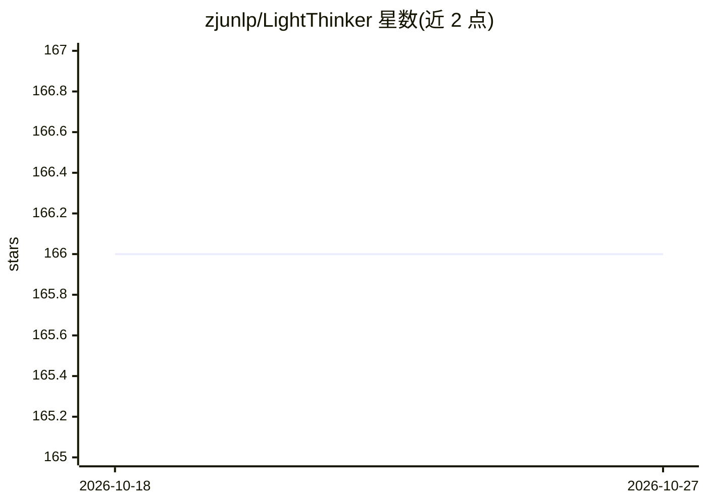

# zjunlp/LightThinker

⭐ 166 · Python · MIT · 推送 2026-06-22 · [GitHub](https://github.com/zjunlp/LightThinker) · 组织维护 · 中文 README

**面向研究者的 LLM 推理压缩与记忆管理方法代码库**

发布 EMNLP 2025 论文 LightThinker 及后续 LightThinker++ 的官方实现：将中间思考压缩为紧凑 gist-token 表示，或通过 commit/expand/fold/final_answer 等记忆原语在推理过程中管理草稿区。仓库按通用推理（GSM8K/MMLU/GPQA/BBH）、agentic 深度研究与 v1 基线分为三个模块，各模块提供模型、SFT 数据与配置，顶层 README 为快速上手指南，详细参数在各模块 README 中。SFT 使用 ms-swift 框架，安装以 conda 环境与脚本为主。

## 筛选速览

| 维度 | 判定 | 备注 |
|---|---|---|
| AI 角色 | `ai-native` | 本体是模型或模型工具 |
| 许可风险 | `permissive` | MIT |
| 部署形态 | `None` |  |
| 模型依赖 | — | README 未给出锁定关系 |
| 硬件要求 | — | 无带数字的原话,不猜 |
| 安装摩擦 | `low` | 无编译、无系统依赖或容器化 |
| 成熟度 | — | 结构信号不足 |

## 能力要点

- LightThinker 将中间思考压缩为 gist-token 表示
- LightThinker++ 提供显式自适应记忆管理（commit/expand/fold/final_answer）
- 三个模块：通用推理、agentic 推理、v1 与 AnLLM 基线
- 各模块提供模型、SFT 数据与完整配置

## 适用场景

- 复现论文中的推理压缩与记忆管理实验
- 在数学与通用推理基准上训练/评估压缩后的模型
- 在长程 deep-research 任务中管理推理中间状态

## 场景标签

`微调` `Agent 记忆` · 领域:Agent 开发

## 证据(README 行号)

> L23: LLMs can solve increasingly complex reasoning tasks, but long thought traces make inference expensive because the m
> L25: - **LightThinker** compresses intermediate thoughts into compact gist-token representations. The implementation and
> L26: - **LightThinker++** introduces explicit adaptive memory management. The model can use memory primitives such as `c

## 星数曲线

2026-10-18 166 → 2026-10-27 166（+0）

---
*卡片 v1 · prompt 1.4 · 生成 2026-10-22 · 置信度 high · 依据 README sha `c1450a37b863` · [字段定义](../../DATASET.md)*
