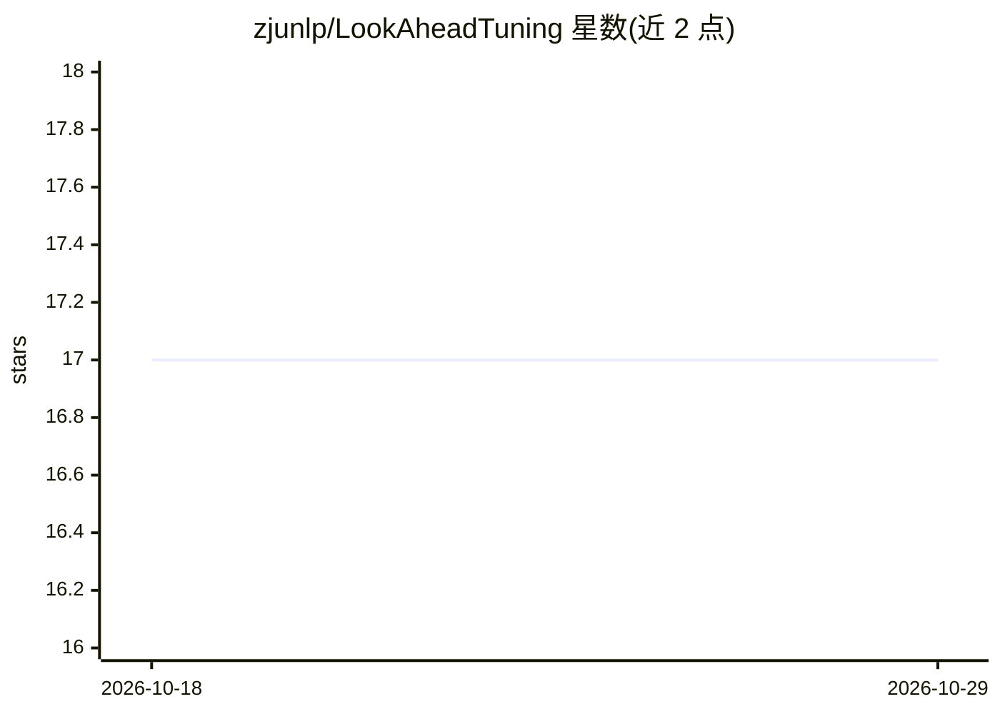

# zjunlp/LookAheadTuning

⭐ 17 · Python · MIT · 推送 2025-12-14 · [GitHub](https://github.com/zjunlp/LookAheadTuning) · 组织维护 · 中文 README

**通过部分答案预览改造训练数据以保持模型安全性的微调方法**

WSDM 2026 论文 LookAhead Tuning 的官方代码库，提供两种数据中心的微调方法：在训练数据中预览答案前缀 token，降低这些 token 的损失，减少对模型初始 token 的扰动，从而在下游任务微调时保持模型安全性。包含 main.py 数据处理脚本（real/virtual 两种模式，支持 JSON/JSONL），训练与安全评估流程复用 shallow-vs-deep-alignment 仓库，需 4 张 A100/H100 80GB GPU。给需要复现论文实验的安全对齐研究者使用。

## 筛选速览

| 维度 | 判定 | 备注 |
|---|---|---|
| AI 角色 | `ai-ecosystem` | LLM/agent 周边工具 |
| 许可风险 | `permissive` | MIT |
| 部署形态 | `library` | 以包/库形式分发 |
| 模型依赖 | — | README 未给出锁定关系 |
| 硬件要求 | — | 无带数字的原话,不猜 |
| 安装摩擦 | `low` | 无编译、无系统依赖或容器化 |
| 成熟度 | — | 结构信号不足 |

## 能力要点

- real/virtual 双模式答案前缀预览数据处理脚本，支持 JSON/JSONL
- 训练与评估流程基于 shallow-vs-deep-alignment 框架
- 安全率评估支持关键词与 GPT 两种方法，效用评估含 rouge1/gsm8k
- 数据来源 GSM8K、Samsum、HEx-PHI 数据集

## 适用场景

- 复现论文中保持安全性的微调实验
- 为自己的微调数据构造答案前缀预览
- 对微调后模型做效用与安全率评估

## 场景标签

`微调` · 领域:训练与推理

## 证据(README 行号)

> L18: LookAhead Tuning comprises two data-centric, resource-efficient, simple, and effective methods. The fundamental con
> L2:  Safer Language Models via Partial Answer Previews
> L12: Our dataset is sourced from the GSM8K dataset, the Samsum dataset, and the HEx-PHI dataset . Our training code and 

## 星数曲线

2026-10-18 17 → 2026-10-29 17（+0）

---
*卡片 v1 · prompt 1.4 · 生成 2026-10-29 · 置信度 mid · 依据 README sha `5123ecfad7a0` · [字段定义](../../DATASET.md)*
