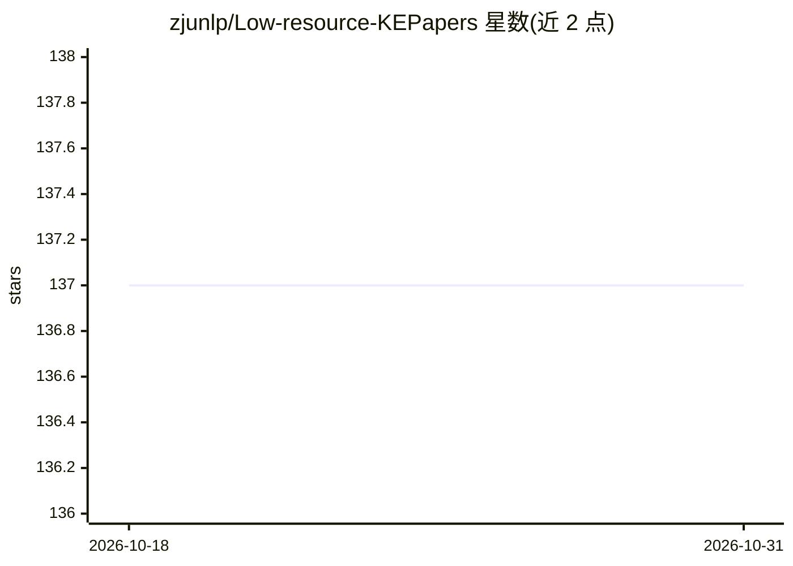

# zjunlp/Low-resource-KEPapers

⭐ 137 · MIT · 推送 2026-10-14 · [GitHub](https://github.com/zjunlp/Low-resource-KEPapers) · 组织维护 · 中文 README

**低资源信息抽取论文清单：NER/RE/EE 方法、工具与数据集**

由 zjunlp 维护的低资源信息抽取（IE）论文汇编，覆盖命名实体识别（NER）、关系抽取（RE）与事件抽取（EE），按传统方法与 LLM-based 方法两大范式组织：传统方法分为利用高资源数据、构建数据高效模型、数据与模型协同优化；LLM 方法分为免调优直接推断与微调模型特化。另收录 IE 工具包（DeepKE、OpenUE 等）、低资源数据集（Few-NERD、FewRel 等）及相关综述，接受社区 PR 更新。

## 筛选速览

| 维度 | 判定 | 备注 |
|---|---|---|
| AI 角色 | `ai-knowledge` | 知识聚合/清单类 |
| 许可风险 | `permissive` | MIT |
| 部署形态 | `None` |  |
| 模型依赖 | — | README 未给出锁定关系 |
| 硬件要求 | — | 无带数字的原话,不猜 |
| 安装摩擦 | `low` | 无编译、无系统依赖或容器化 |
| 成熟度 | — | 结构信号不足 |

## 能力要点

- 按传统/LLM-based 两大范式组织论文条目
- 收录传统与 LLM-based 两类 IE 工具包
- 收录 NER/RE/EE 低资源数据集（Few-NERD、FewRel、FewEvent 等）
- 附相关综述与教程 slides（CCKS/AACL-IJCNLP/IJCAI）

## 适用场景

- 低资源信息抽取方向的文献调研
- 寻找可用的 IE 工具包与基准数据集
- 了解传统与 LLM-based 低资源 IE 方法的分类脉络

## 场景标签

`科研工具` `精选清单` `教程课程` · 领域:学习与行业

## 证据(README 行号)

> L3: 🍎 The repository is a paper set on low-resource information extraction (IE), mainly including NER, RE and EE, which 
> L15: 📖 **Survey Paper**: Information Extraction in Low-Resource Scenarios: Survey and Perspective (ICKG 2024) \[paper\]

## 星数曲线

2026-10-18 137 → 2026-10-31 137（+0）

---
*卡片 v1 · prompt 1.4 · 生成 2026-10-22 · 置信度 high · 依据 README sha `1d4505fca799` · [字段定义](../../DATASET.md)*
