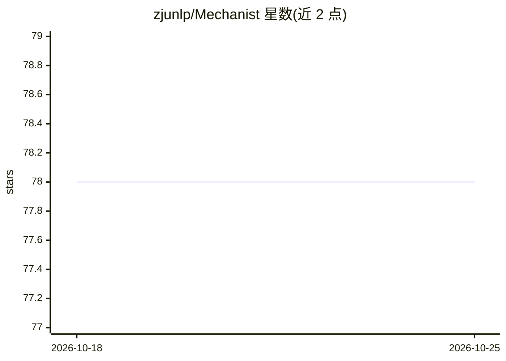

# zjunlp/Mechanist

⭐ 78 · Python · MIT · 推送 2026-09-17 · [GitHub](https://github.com/zjunlp/Mechanist) · [官网](http://mechanist.openkg.cn/) · 组织维护 · 中文 README

**LLM 机制可解释性自主研究 agent：从问题到证据支撑的研究结论**

以 Claude Code 插件形式交付的自主研究流水线：面向大模型内部机制的研究问题，协调文献检索（14k 篇可解释性语料与 157M 节点引文图）、假设提出、实验代码生成与执行、稳健性验证和最多 6 轮迭代修正，产出按 claim 组织的研究报告与 CLAIMS_LEDGER。需在用户本机与 GPU 上运行实验，要求 Claude Code + uv + 外部评审模型 API key（推荐非 Claude 系列模型）。

## 筛选速览

| 维度 | 判定 | 备注 |
|---|---|---|
| AI 角色 | `ai-native` | 本体是模型或模型工具 |
| 许可风险 | `permissive` | MIT |
| 部署形态 | `library` | 以包/库形式分发 |
| 模型依赖 | locked-api |  |
| 硬件要求 | — | 无带数字的原话,不猜 |
| 安装摩擦 | `low` | 无编译、无系统依赖或容器化 |
| 成熟度 | — | 结构信号不足 |

## 能力要点

- claim→experiment→verify→iterate 四阶段流水线，各阶段产物落盘可审计
- 文献检索覆盖 14k 篇可解释性语料与 157M 节点跨学科引文图
- 外部独立模型逐阶段交叉评审，避免同模型自评
- 以 Claude Code 插件分发，无需克隆仓库

## 适用场景

- 让 agent 自主定位某个模型行为的内部机制成因
- 按原规模复现可解释性论文的发现与方法
- 在文献库中检索某主题或梳理领域发展时间线
- 对已有假设做多种模型/数据集/方法轴上的稳健性验证

## 场景标签

`科研工具` · 领域:学习与行业

## 证据(README 行号)

> L27: **Mechanist** converts a research question about the internal mechanisms of large language models into **evidence-b
> L29: **Mechanist ships as a Claude Code plugin** — no repository clone required. Install it in minutes, hand it a resear

## 星数曲线

2026-10-18 78 → 2026-10-25 78（+0）

---
*卡片 v1 · prompt 1.4 · 生成 2026-10-24 · 置信度 mid · 依据 README sha `76473dc842ef` · [字段定义](../../DATASET.md)*
