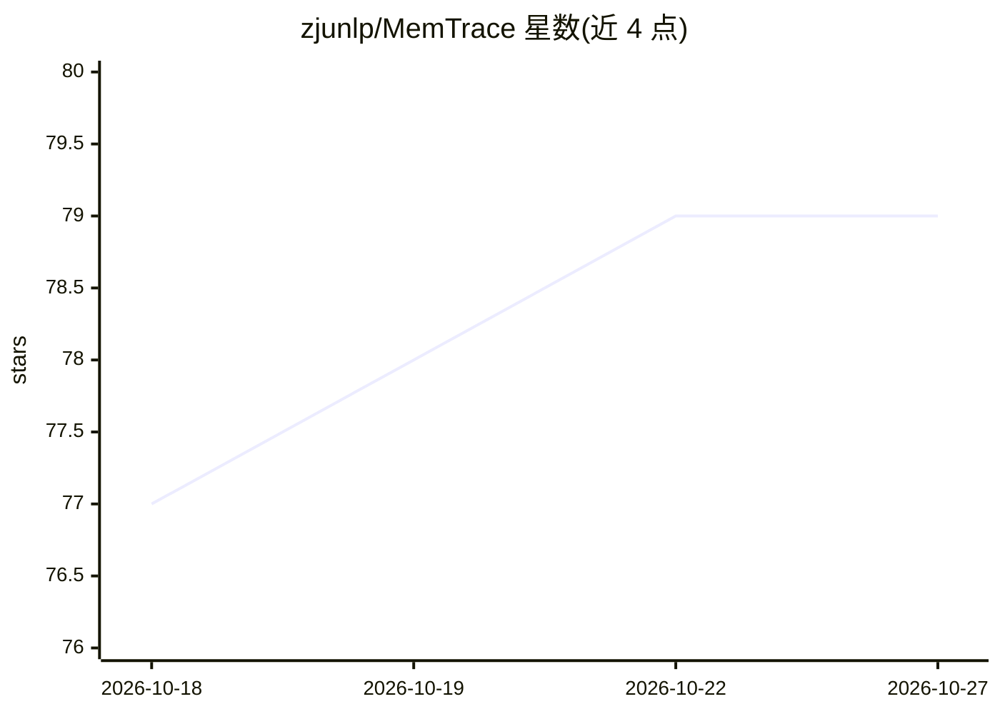

# zjunlp/MemTrace

⭐ 79 · Python · MIT · 推送 2026-07-17 · [GitHub](https://github.com/zjunlp/MemTrace) · 组织维护 · 中文 README

**LLM 记忆系统错误溯源工具：定位错误引入的操作步骤**

面向开发者的 LLM 记忆系统调试研究项目：将记忆系统（提取、更新、检索、生成等）的执行过程记录为操作-变量执行图，对失败案例反向追踪，自动定位最可能引入错误的具体操作并预测错误类型。包含 smartcomment 追踪工具包、人工标注的 MemTraceBench 基准（覆盖 Long-Context/RAG/Mem0/EverMemOS）以及诊断报告与基于归因反馈的提示词自动优化流程。需 Python>=3.12，通过 git clone 源码安装，依赖 OpenAI 兼容 API 与 vLLM 服务的嵌入模型。

## 筛选速览

| 维度 | 判定 | 备注 |
|---|---|---|
| AI 角色 | `ai-ecosystem` | LLM/agent 周边工具 |
| 许可风险 | `permissive` | MIT |
| 部署形态 | `library` | 以包/库形式分发 |
| 模型依赖 | local-ok | 支持本地模型 |
| 硬件要求 | — | 无带数字的原话,不猜 |
| 安装摩擦 | `low` | 无编译、无系统依赖或容器化 |
| 成熟度 | — | 结构信号不足 |

## 能力要点

- 将记忆系统执行过程记录为操作-变量执行图
- 图上自动归因：定位致错操作并预测错误类型
- MemTraceBench 人工标注失败案例基准（RAG/Mem0/EverMemOS/Long-Context）
- 归因结果转化为诊断报告与提示词自动优化

## 适用场景

- 调试 LLM 记忆系统回答错误时定位出错环节
- 在基准数据上评测错误归因方法
- 基于归因反馈自动优化 Mem0 的提示词

## 场景标签

`LLM 可观测性` `模型评测` · 领域:评测与运维

## 证据(README 行号)

> L29: **MemTrace** helps developers understand why an LLM memory system gives a wrong answer. A memory system may read ma
> L31: MemTrace records this whole process as an **operation-variable execution graph**. Variables are the concrete things
> L37: - **Graph-based automatic attribution**, which inspects operation subgraphs to locate the decisive faulty operation

## 星数曲线

2026-10-18 77 → 2026-10-27 79（+2）

---
*卡片 v1 · prompt 1.4 · 生成 2026-10-24 · 置信度 mid · 依据 README sha `8bbae8bb243b` · [字段定义](../../DATASET.md)*
