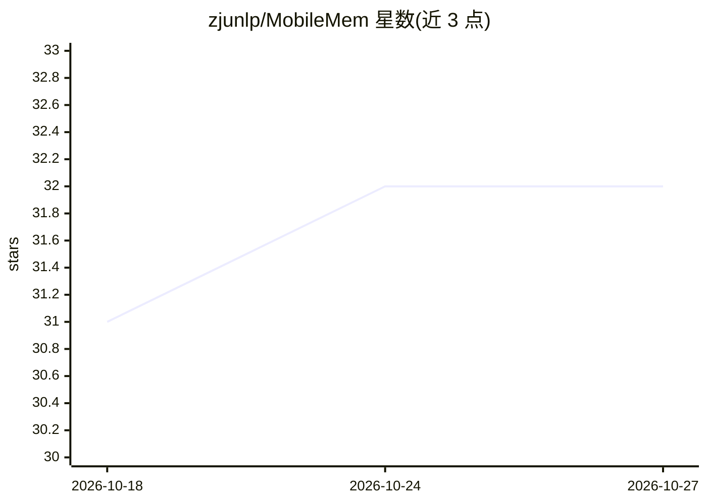

# zjunlp/MobileMem

⭐ 32 · Python · MIT · 推送 2026-10-12 · [GitHub](https://github.com/zjunlp/MobileMem) · [官网](https://zjunlp.github.io/MobileMem/) · 组织维护 · 中文 README

**移动端设备上记忆系统的评测基准与数据集（三赛道）**

评测移动设备场景下 on-device 记忆系统的基准框架，由多个异构来源构建，含三个互补赛道：text（长程用户-助手对话与移动应用事件）、omni（截图与照片的多模态交互）、struct（设备端应用的结构化模拟数据）。数据集托管于 HuggingFace，各赛道提供数据获取、评测复现与数据构建流程指引；评测复现指南位于 MemBase 仓库，另推荐 MemTrace 工具做错误分析。作者来自多所高校团队（浙大等）。

## 筛选速览

| 维度 | 判定 | 备注 |
|---|---|---|
| AI 角色 | `ai-knowledge` | 知识聚合/清单类 |
| 许可风险 | `permissive` | MIT |
| 部署形态 | `None` |  |
| 模型依赖 | — | README 未给出锁定关系 |
| 硬件要求 | — | 无带数字的原话,不猜 |
| 安装摩擦 | `low` | 无编译、无系统依赖或容器化 |
| 成熟度 | — | 结构信号不足 |

## 能力要点

- text/omni/struct 三个互补赛道的移动记忆评测
- 覆盖文本、图文多模态与结构化数据
- 提供 KEME 轨迹合成与数据集重建流程
- 配套 MemTrace 错误可视化分析工具

## 适用场景

- 评测我的 agent 记忆系统在移动长程任务上的表现
- 获取移动场景多模态交互数据训练记忆模块
- 复现榜单结果并诊断记忆系统失败原因

## 场景标签

`Agent 记忆` `模型评测` · 领域:Agent 开发

## 证据(README 行号)

> L9: **MobileMem** is a comprehensive benchmarking framework for evaluating **on-device memory systems** in realistic mob
> L28: MobileMem contains three complementary tracks:

## 星数曲线

2026-10-18 31 → 2026-10-27 32（+1）

---
*卡片 v1 · prompt 1.4 · 生成 2026-10-25 · 置信度 high · 依据 README sha `7b662a2dcd9f` · [字段定义](../../DATASET.md)*
