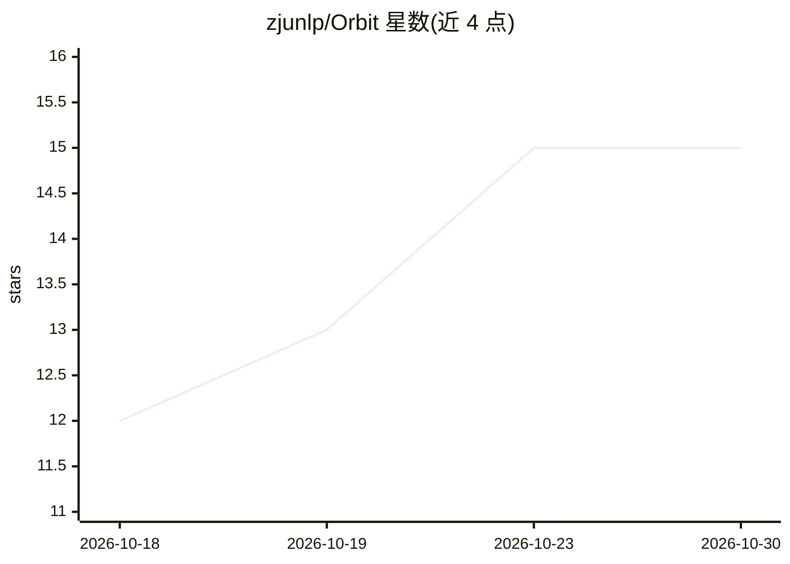

# zjunlp/Orbit

⭐ 15 · TypeScript · MIT · 推送 2026-10-21 · [GitHub](https://github.com/zjunlp/Orbit) · 组织维护 · 中文 README

**给 AI agent 用的实验基础设施：执行、记录、评测实验**

面向 Codex、Claude Code 等编码 agent 的实验执行平台：提供 Docker 隔离运行、GPU/CPU/内存资源调度与队列、代码快照、日志与指标记录，以及 Web UI 中的轨迹回看（运行详情、代码 diff、agent 会话、跨运行对比）。附带基准测试框架，支持 Harbor 格式、ASI、LongDS 与外部 JSON 协议适配器，区分执行有效性与评分有效性。以 npm 包形式安装（含 CLI、daemon、Web UI 与共享技能），需 Linux、Node.js 24.18+、Git 与 Docker；具身设备支持与自动轨迹学习为路线图方向。项目自述处于早期开发阶段。

## 筛选速览

| 维度 | 判定 | 备注 |
|---|---|---|
| AI 角色 | `ai-ecosystem` | LLM/agent 周边工具 |
| 许可风险 | `permissive` | MIT |
| 部署形态 | `self-host` | docker 或自建部署 |
| 模型依赖 | — | README 未给出锁定关系 |
| 硬件要求 | — | 无带数字的原话,不猜 |
| 安装摩擦 | `low` | 无编译、无系统依赖或容器化 |
| 成熟度 | `idea` | |

## 能力要点

- Docker 隔离执行与 GPU/CPU/内存租约调度，支持多机与队列原因展示
- Web UI 回看轨迹：日志、指标图、代码 diff 与 agent 会话
- 参数扫描（sweep）与任务×方法×种子基准作业，执行/评分/清理分开记录
- 为 Codex、Claude Code、dsh、pi 提供宿主技能与容器内 agent 支持

## 适用场景

- 让编码 agent 在受控 Docker 环境中跑训练/评测实验并留存证据
- 团队共享 GPU 资源排实验，带队列与租约管理
- 在同一资源规则下对比不同 agent 方法的基准成绩

## 场景标签

`模型评测` `MLOps` · 领域:评测与运维

## 证据(README 行号)

> L14: **Orbit is experiment infrastructure for agents.** Our vision is to let agents run experiments
> L20: Today, Orbit gives agents such as Codex and Claude Code Docker execution, GPU / CPU / memory
> L35: |📊 **Verifiable evaluation**|Task × method × seed jobs with execution and score validity tracked separately; Harbor

## 星数曲线

2026-10-18 12 → 2026-10-30 15（+3）

---
*卡片 v1 · prompt 1.4 · 生成 2026-10-30 · 置信度 mid · 依据 README sha `be4b2a19680c` · [字段定义](../../DATASET.md)*
