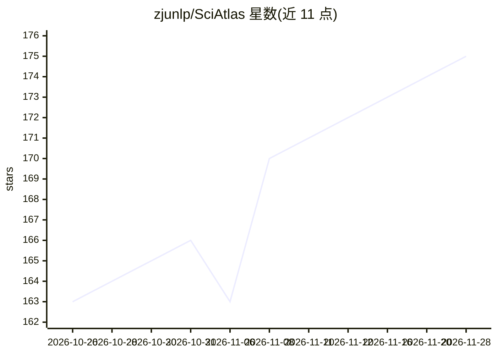

# zjunlp/SciAtlas

⭐ 175 · Python · MIT · 推送 2026-10-22 · [GitHub](https://github.com/zjunlp/SciAtlas) · [官网](http://sciatlas.openkg.cn/) · 组织维护 · 中文 README

**面向科研人员的文献知识图谱 CLI 客户端与研究工作流工具**

托管 SciAtlas 科学知识图谱 API 的 pip 可安装客户端与 CLI。底层图谱连接论文、作者、机构、期刊、引用及四级研究分类体系，检索可沿图结构传播而非仅关键词匹配。CLI 提供论文检索、相关作者发现、文献综述、想法落地/评估/生成、趋势分析、研究者画像等 12 类任务，输出 Markdown 报告与可复现的 JSON 工件；附带可移植的 Agent Skill 包，可接入编码类 agent。核心检索无需本地模型，部分下游工作流需自配 LLM API key；本地 PDF 处理需可选部署 GROBID。

## 筛选速览

| 维度 | 判定 | 备注 |
|---|---|---|
| AI 角色 | `ai-native` | 本体是模型或模型工具 |
| 许可风险 | `permissive` | MIT |
| 部署形态 | `desktop` | 安装包/桌面程序 |
| 模型依赖 | — | README 未给出锁定关系 |
| 硬件要求 | — | 无带数字的原话,不猜 |
| 安装摩擦 | `low` | 无编译、无系统依赖或容器化 |
| 成熟度 | — | 结构信号不足 |

## 能力要点

- 基于大规模科学知识图谱的图感知论文检索（关键词+语义+图传播）
- 12 类 CLI 任务：文献综述、idea 评估/生成、趋势分析、作者画像等
- 输出 request.json/response.json 机器可读工件与 report.md 报告
- Agent Skill 包可接入 Codex、Claude Code 等编码 agent 做端到端任务

## 适用场景

- 围绕一个研究主题快速获得带证据的文献列表和报告
- 对研究想法做落地检索与自动化评估
- 追踪领域趋势并整理代表性工作
- 为研究选题生成 idea 种子并寻找差异化证据

## 场景标签

`知识图谱` `RAG` `科研工具` · 领域:知识与检索

## 证据(README 行号)

> L7:  A pip-installable client and CLI for literature-grounded scientific research workflows on top of the hosted SciAtla
> L26: SciAtlas is a research map you can use from the command line. Give it a topic, an idea, an author, or a paper trail
> L43: - **research workflow automation**: run literature review, idea grounding, idea evaluation, idea generation, trend 

## 星数曲线

2026-10-26 163 → 2026-11-28 175（+12）

---
*卡片 v1 · prompt 1.4 · 生成 2026-11-26 · 置信度 mid · 依据 README sha `fe6eafe5552c` · [字段定义](../../DATASET.md)*
