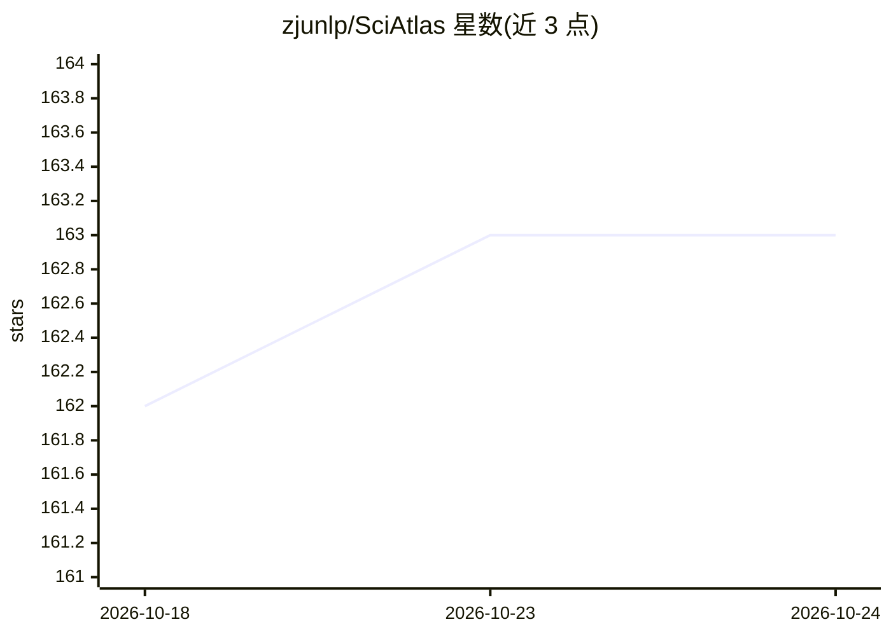

# zjunlp/SciAtlas

⭐ 163 · Python · MIT · 推送 2026-10-22 · [GitHub](https://github.com/zjunlp/SciAtlas) · [官网](http://sciatlas.openkg.cn/) · 组织维护 · 中文 README

**科研知识图谱及其客户端：文献检索与科研工作流自动化**

SciAtlas 提供连接论文、作者、机构、引文与四级研究分类体系的大规模科研知识图谱，并以 pip 可安装的客户端与 CLI 形式托管 API 访问该图谱。用户输入主题、想法或作者，可运行图感知论文检索、文献综述、想法评估、想法生成、趋势分析等任务，输出可复现的 JSON 工件与 Markdown 报告。需注册个人 API token；本地 PDF 处理依赖 GROBID（Docker），想法评估需下载 bge 嵌入与重排模型（各约 1.3GB，无需 GPU）。附带的 Agent Skill 包可将检索与工作流迁移到 Codex、Claude Code 等编码代理中。

## 筛选速览

| 维度 | 判定 | 备注 |
|---|---|---|
| AI 角色 | `ai-knowledge` | 知识聚合/清单类 |
| 许可风险 | `permissive` | MIT |
| 部署形态 | `desktop` | 安装包/桌面程序 |
| 模型依赖 | — | README 未给出锁定关系 |
| 硬件要求 | — | 无带数字的原话,不猜 |
| 安装摩擦 | `low` | 无编译、无系统依赖或容器化 |
| 成熟度 | — | 结构信号不足 |

## 能力要点

- 图感知论文检索：关键词、语义匹配、引用与图传播结合
- 覆盖文献综述、想法评估/生成、趋势分析、作者画像等任务
- 输出可复现工件（request.json/response.json）与可编辑 CLI 技能注册表
- Agent Skill 包支持迁移到 Codex、Claude Code 等编码代理

## 适用场景

- 围绕一个研究主题做图感知的文献检索与综述
- 评估或生成研究想法并获取相关工作佐证
- 把 SciAtlas 检索接入编码代理做端到端科研任务
- 分析研究趋势或梳理某学者的研究轨迹

## 场景标签

 · 领域:科研/AI for Science

## 证据(README 行号)

> L7:  A pip-installable client and CLI for literature-grounded scientific research workflows on top of the hosted SciAtla
> L26: SciAtlas is a research map you can use from the command line. Give it a topic, an idea, an author, or a paper trail
> L28: Behind that simple workflow is a large scientific knowledge graph. SciAtlas connects papers, authors, institutions,

## 星数曲线

2026-10-18 162 → 2026-10-24 163（+1）

---
*卡片 v1 · prompt 1.4 · 生成 2026-10-22 · 置信度 mid · 依据 README sha `e67db5d49366` · [字段定义](../../DATASET.md)*
