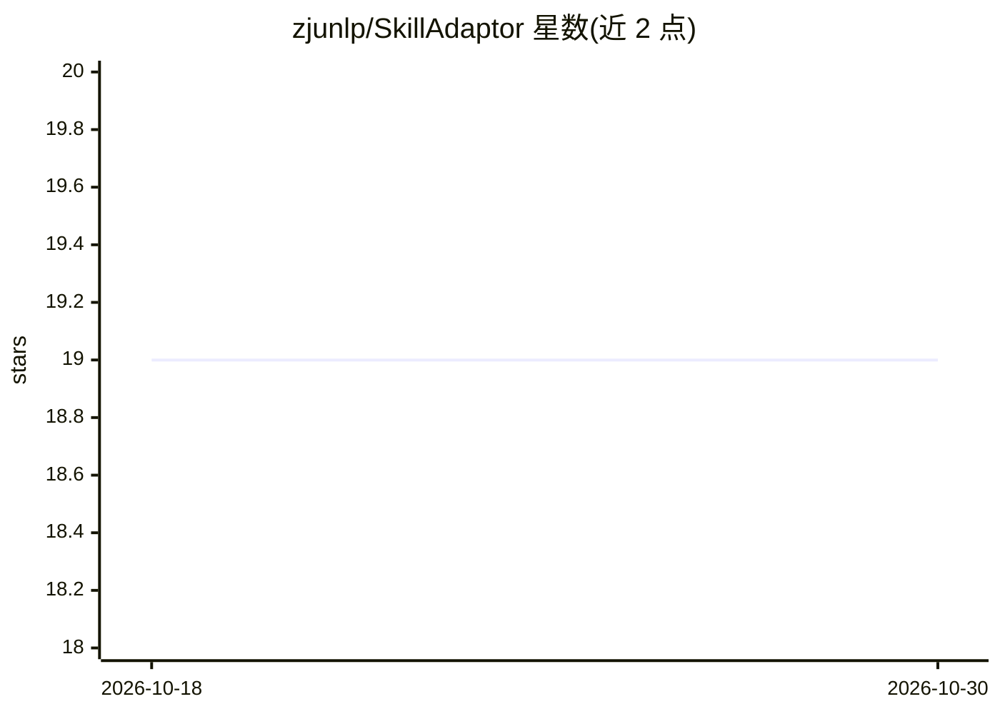

# zjunlp/SkillAdaptor

⭐ 19 · Python · MIT · 推送 2026-07-16 · [GitHub](https://github.com/zjunlp/SkillAdaptor) · 组织维护 · 中文 README

**从失败轨迹自动演化 LLM Agent 技能文件的 Python CLI 工具**

面向 LLM Agent 开发者的技能自适应工具：分析失败运行轨迹，通过 Localizer 定位最早出错步骤、Linker 归因技能、Reviser/Generator 修补或新建 SKILL.md、Validator 在留出任务上复跑并仅在改进时采纳。产出的技能同步到工作区并可接入 OpenClaw、Claude Code、Codex CLI、Hermes Agent 四种执行框架。以 Python CLI 运行，需配置 chat 与 embedding 两组 API key；轨迹仅支持含工具调用的步骤。

## 筛选速览

| 维度 | 判定 | 备注 |
|---|---|---|
| AI 角色 | `ai-ecosystem` | LLM/agent 周边工具 |
| 许可风险 | `permissive` | MIT |
| 部署形态 | `library` | 以包/库形式分发 |
| 模型依赖 | locked-api |  |
| 硬件要求 | — | 无带数字的原话,不猜 |
| 安装摩擦 | `low` | 无编译、无系统依赖或容器化 |
| 成熟度 | — | 结构信号不足 |

## 能力要点

- Localizer→Linker→Reviser/Generator→Validator 的四阶段技能演化流水线
- 支持 OpenClaw / Claude Code / Codex CLI / Hermes Agent 四种 harness
- 技能仅按检索相关性注入（retrieval-gated inject）
- 产出 skills/<id>/SKILL.md 并同步到 agent 技能路径

## 适用场景

- 让 agent 从失败任务轨迹中自动沉淀可复用技能
- 为 Claude Code / Codex 等 CLI agent 维护 SKILL.md 技能库
- 通过留出任务验证技能是否带来实际改进

## 场景标签

`提示工程` · 领域:Agent 开发

## 证据(README 行号)

> L16: **SkillAdaptor** evolves agent **`SKILL.md`** files from failure trajectories. Run it as a Python CLI on any worksp
> L18: - **Step-level attribution** — On a failed run, the **Localizer** finds the earliest bad step **t★**; the **Linker*

## 星数曲线

2026-10-18 19 → 2026-10-30 19（+0）

---
*卡片 v1 · prompt 1.4 · 生成 2026-10-28 · 置信度 mid · 依据 README sha `3ac9bb379cb5` · [字段定义](../../DATASET.md)*
