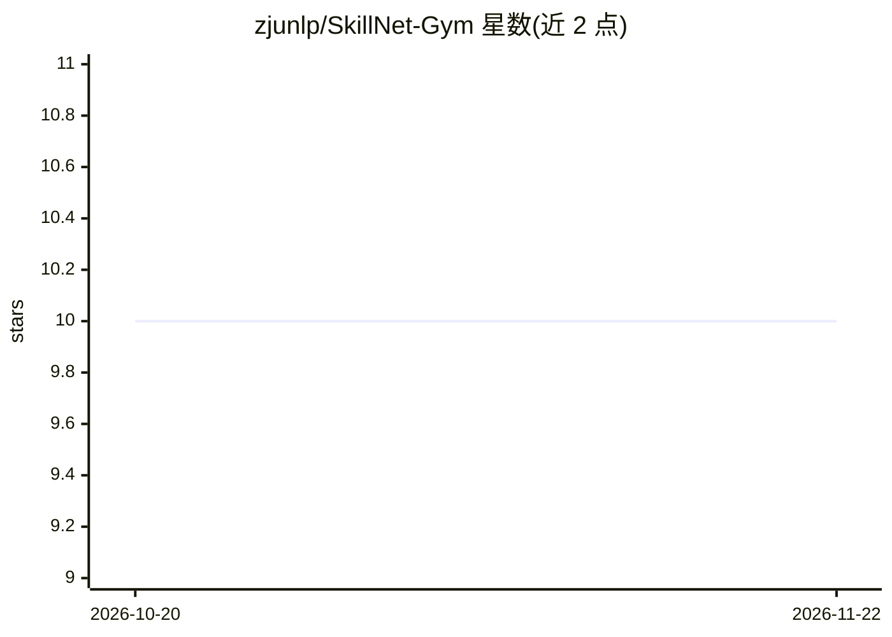

# zjunlp/SkillNet-Gym

⭐ 10 · Python · NOASSERTION · 推送 2026-08-25 · [GitHub](https://github.com/zjunlp/SkillNet-Gym) · 组织维护 · 中文 README

**面向 LLM agent 技能组合学习的动态基准与任务自动合成流水线**

从社区技能与网络材料构建可扩展的 SkillNet 有向技能图，自动采样链式/扇入/扇出/菱形拓扑合成可执行任务，配合确定性验证器打包为基准任务。统一评估六种设置：无技能、官方技能使用、技能构建、技能检索、技能编排与真实环境端到端执行，指标包括 Avg@k 通过率与检索/编排的查全查准。评估兼容 Harbor 框架，支持 Docker 或本地 Conda 运行，提供 Claude Code 与 Codex 并行隔离执行；附任务自动合成代码与完整评估流水线，覆盖 13 个核心领域、81 个子领域。

## 筛选速览

| 维度 | 判定 | 备注 |
|---|---|---|
| AI 角色 | `ai-ecosystem` | LLM/agent 周边工具 |
| 许可风险 | `permissive` | NOASSERTION |
| 部署形态 | `self-host` | docker 或自建部署 |
| 模型依赖 | — | README 未给出锁定关系 |
| 硬件要求 | — | 无带数字的原话,不猜 |
| 安装摩擦 | `low` | 无编译、无系统依赖或容器化 |
| 成熟度 | — | 结构信号不足 |

## 能力要点

- 从活技能生态动态合成任务，基准随生态演进而非固定快照
- 六种设置统一评估技能构建、检索与组合，可定位失败环节
- 任务自带文件、gold 技能、依赖边与确定性验证器，可作自适应优化目标
- 两阶段流水线：技能图构建（skillnet_gym.graph）+ 任务自动合成（skillnet_gym.synthesis）

## 适用场景

- 评估 agent 检索、构建与组合技能的能力
- 定位 agent 失败来自蒸馏、检索、依赖排序还是执行
- 为自适应 agent 提供 evaluate→diagnose→adapt 的评测闭环
- 基于自身语料构建新的动态技能基准

## 场景标签

`模型评测` · 领域:评测与运维

## 证据(README 行号)

> L29: **SkillNet-Gym** is a dynamic benchmark for evaluating compositional skill learning. Instead of freezing a manually
> L33: - **Unified evaluation of Skill Construction and Skill Composition.** SkillNet-Gym places no-skill solving, officia
> L82: For end-to-end task execution and skill composition, we directly use the Harbor evaluation framework.

## 星数曲线

2026-10-20 10 → 2026-11-22 10（+0）

---
*卡片 v1 · prompt 1.4 · 生成 2026-11-19 · 置信度 mid · 依据 README sha `121a02d615ec` · [字段定义](../../DATASET.md)*
