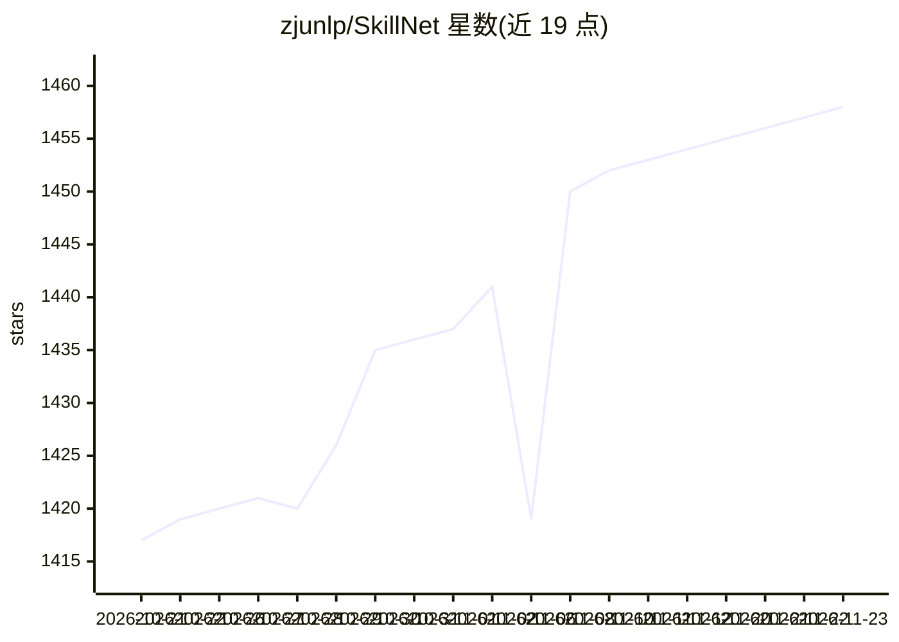

# zjunlp/SkillNet

⭐ 1,458 · Python · MIT · 推送 2026-11-02 · [GitHub](https://github.com/zjunlp/SkillNet) · [官网](http://skillnet.openkg.cn/) · 组织维护 · 中文 README

**面向 agent 开发者的 AI 技能发现、评估与路由基础设施**

SkillNet 提供 agent 技能全生命周期的统一基础设施：按关键词或语义检索公开技能库（已索引 500K+ GitHub 技能）、从 GitHub 下载技能到本地工作区、从仓库/文档/提示/执行轨迹生成技能包、按安全性/完整性/可执行性/可维护性/成本五个维度评估，并提取能力与场景构建关系图（compose_with/similar_to），据此为任务路由选择技能。以 Python SDK、CLI、本地浏览器界面与公开 REST API 形式提供；create/evaluate/analyze 需 OpenAI 兼容端点，route 另需 Claude、Codex 或 DeepSeek Harness SDK。

## 筛选速览

| 维度 | 判定 | 备注 |
|---|---|---|
| AI 角色 | `ai-ecosystem` | LLM/agent 周边工具 |
| 许可风险 | `permissive` | MIT |
| 部署形态 | `self-host` | docker 或自建部署 |
| 模型依赖 | — | README 未给出锁定关系 |
| 硬件要求 | — | 无带数字的原话,不猜 |
| 安装摩擦 | `low` | 无编译、无系统依赖或容器化 |
| 成熟度 | — | 结构信号不足 |

## 能力要点

- 公开技能库检索：BM25 关键词与向量语义两种模式
- 六项操作覆盖技能发现、安装、生成、评估、分析、路由
- 本地技能关系图（compose_with/similar_to）与任务 Wiki 路由
- 提供 Python SDK、CLI、本地 UI 与公开搜索 REST API

## 适用场景

- 为 agent 工作流检索并安装可复用的技能包
- 评估本地或 GitHub 上的技能质量
- 从执行轨迹或仓库生成结构化技能包
- 为给定任务从本地技能库选择合适技能

## 场景标签

`知识图谱` `语义搜索` `Agent 框架` · 领域:Agent 开发

## 证据(README 行号)

> L7: **Open infrastructure for discovering, evaluating, analyzing, and routing reusable AI agent skills.**
> L22: SkillNet provides unified infrastructure for the agent skill lifecycle:
> L246: Search and public downloads need no API key. Create, evaluate, and analyze use an

## 星数曲线

2026-10-21 1,417 → 2026-11-23 1,458（+41）

---
*卡片 v1 · prompt 1.4 · 生成 2026-11-23 · 置信度 mid · 依据 README sha `40bf5086ba71` · [字段定义](../../DATASET.md)*
