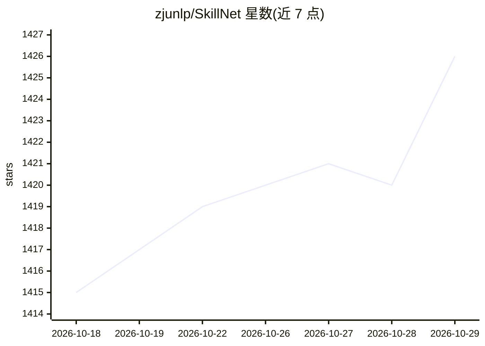

# zjunlp/SkillNet

⭐ 1,426 · Python · MIT · 推送 2026-10-13 · [GitHub](https://github.com/zjunlp/SkillNet) · [官网](http://skillnet.openkg.cn/) · 组织维护 · 中文 README

**面向开发者的 AI agent 技能发现、评估与路由基础设施**

SkillNet 提供 agent 技能全生命周期工具：从 50 万+ GitHub 技能索引中按关键词或语义检索、下载技能到本地工作区、从提示词/仓库/文档/执行轨迹生成技能包、按安全性等五个维度评估技能、构建本地场景关系图与检索索引，并为任务路由选择技能。以 pip 安装的 Python SDK 提供，附 CLI、本地浏览器界面与公开 REST 搜索 API（无需鉴权）。create/evaluate/analyze 需配置 OpenAI 兼容端点，route 需 Claude 或 Codex Agent SDK。

## 筛选速览

| 维度 | 判定 | 备注 |
|---|---|---|
| AI 角色 | `ai-ecosystem` | LLM/agent 周边工具 |
| 许可风险 | `permissive` | MIT |
| 部署形态 | `self-host` | docker 或自建部署 |
| 模型依赖 | — | README 未给出锁定关系 |
| 硬件要求 | — | 无带数字的原话,不猜 |
| 安装摩擦 | `low` | 无编译、无系统依赖或容器化 |
| 成熟度 | — | 结构信号不足 |

## 能力要点

- 50 万+ GitHub 技能索引的公开搜索（BM25 关键词与向量语义两种模式）
- 技能五维度评估：安全/完整/可执行/可维护/成本
- 本地技能关系图（compose_with/similar_to）与任务级技能路由
- Python SDK、CLI、本地 UI 与无需鉴权的公开搜索 API

## 适用场景

- 为 agent 查找并下载可复用的技能包
- 评估本地或 GitHub 技能的质量与安全性
- 为具体任务从本地技能库自动选择合适技能

## 场景标签

`Agent 框架` `语义搜索` · 领域:Agent 开发

## 证据(README 行号)

> L7: **Open infrastructure for discovering, evaluating, analyzing, and routing reusable AI agent skills.**
> L22: SkillNet provides unified infrastructure for the agent skill lifecycle:

## 星数曲线

2026-10-18 1,415 → 2026-10-29 1,426（+11）

---
*卡片 v1 · prompt 1.4 · 生成 2026-10-21 · 置信度 mid · 依据 README sha `8b5e175cc238` · [字段定义](../../DATASET.md)*
