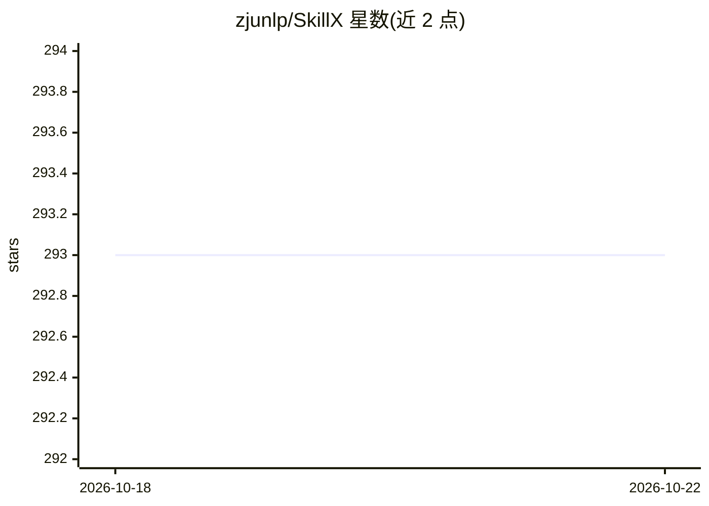

# zjunlp/SkillX

⭐ 293 · Python · MIT · 推送 2026-09-03 · [GitHub](https://github.com/zjunlp/SkillX) · 组织维护 · 中文 README

**从智能体经验中自动构建可复用技能知识库的框架**

面向 LLM 智能体的全自动化框架：读取 JSONL 格式的执行轨迹，由强骨干智能体在训练任务上运行，从成功轨迹中抽取规划级、功能级、原子级三层技能，经过合并、质量过滤与迭代更新构建技能库，并通过探索性扩展发现训练分布外的新技能。产出的技能库可注入到较弱的基座智能体与新环境，无需重训模型。README 声明代码库与技能库为计划发布，当前未见安装与运行命令；在 AppWorld、BFCL-v3、τ2-Bench 上报告了评测结果。

## 筛选速览

| 维度 | 判定 | 备注 |
|---|---|---|
| AI 角色 | `ai-ecosystem` | LLM/agent 周边工具 |
| 许可风险 | `permissive` | MIT |
| 部署形态 | `None` |  |
| 模型依赖 | — | README 未给出锁定关系 |
| 硬件要求 | — | 无带数字的原话,不猜 |
| 安装摩擦 | `low` | 无编译、无系统依赖或容器化 |
| 成熟度 | — | 结构信号不足 |

## 能力要点

- 轨迹→三层技能（规划/功能/原子）的自动抽取流水线
- 技能合并、质量过滤与基于执行反馈的迭代更新
- 探索性扩展：面向欠覆盖工具合成新任务以扩大技能覆盖
- 技能库即插即用，支持强模型到弱模型的跨智能体迁移

## 适用场景

- 为工具调用型智能体沉淀可复用的技能库
- 长程任务中减少重复探索与工具误用
- 把强模型的智能体经验迁移给较弱的基座模型

## 场景标签

 · 领域:LLM 智能体/经验学习

## 证据(README 行号)

> L12: **SkillX** is a fully automated framework that constructs a **reusable, plug-and-play skill knowledge base** for LL
> L46: SkillX provides an end-to-end automated pipeline that:
> L65: ### Plug-and-Play Transfer Across Agents

## 星数曲线

2026-10-18 293 → 2026-10-22 293（+0）

---
*卡片 v1 · prompt 1.4 · 生成 2026-10-22 · 置信度 high · 依据 README sha `bcd765112733` · [字段定义](../../DATASET.md)*
