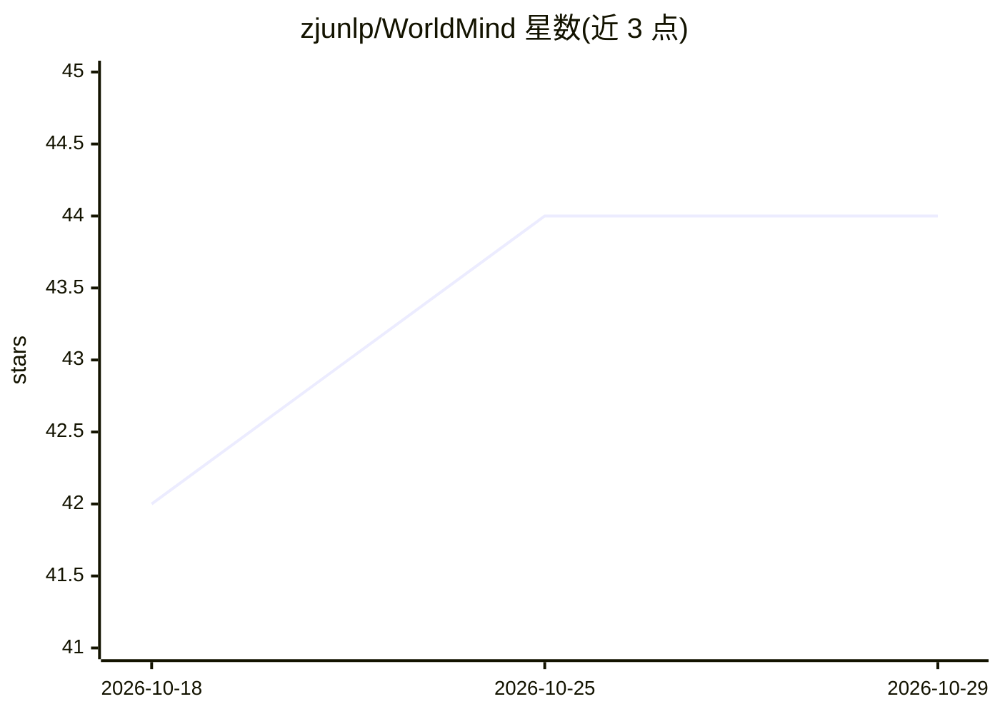

# zjunlp/WorldMind

⭐ 44 · Python · MIT · 推送 2026-05-15 · [GitHub](https://github.com/zjunlp/WorldMind) · [官网](https://zjunlp.github.io/WorldMind/) · 组织维护 · 中文 README

**通过经验学习对齐智能体世界模型的研究框架（EMNLP 2026）**

面向具身智能研究的 training-free 框架：从成功轨迹蒸馏目标经验（启发式）、经 Predict-Act-Verify 循环从预测误差合成过程经验（因果规则），存入世界知识库（WKR），新任务按语义相似度检索并经门控仿真约束规划。基于 EmbodiedBench 支持 EB-ALFRED、EB-Habitat、EB-Navigation 三类具身基准，提供可独立集成的插件。安装需两个 conda 环境，Habitat 需安装 Habitat-Sim、下载数据集并在无头服务器启动 X server；实验通过 YAML 配置与 run.sh 执行，默认调用远程 LLM（gpt-4o-mini）。

## 筛选速览

| 维度 | 判定 | 备注 |
|---|---|---|
| AI 角色 | `ai-ecosystem` | LLM/agent 周边工具 |
| 许可风险 | `permissive` | MIT |
| 部署形态 | `library` | 以包/库形式分发 |
| 模型依赖 | — | README 未给出锁定关系 |
| 硬件要求 | — | 无带数字的原话,不猜 |
| 安装摩擦 | `low` | 无编译、无系统依赖或容器化 |
| 成熟度 | — | 结构信号不足 |

## 能力要点

- training-free：无需梯度更新，从轨迹与预测误差中抽取符号化经验
- 世界知识库（WKR）按语义相似度检索，跨任务与跨环境泛化
- 覆盖 EB-ALFRED/EB-Habitat/EB-Navigation 三个具身基准并给出评测结果
- 提供可嵌入自有环境的世界mind插件（经验抽取与记忆检索模块）

## 适用场景

- 在具身智能基准上评测经验学习对世界模型对齐的效果
- 将经验抽取与检索能力以插件形式接入自定义 agent 环境
- 复现论文中 GPT-3.5/GPT-4.1-mini 等模型上的对比实验

## 场景标签

`模型评测` `Agent 记忆` · 领域:Agent 开发

## 证据(README 行号)

> L30: **WorldMind** is a framework for aligning agentic world models through knowledgeable experience learning, enabling 
> L48: |🌐 **Universal Adaptability**|Seamlessly generalizes across diverse embodied environments (ALFRED, Habitat, Navigat
> L231: ## 🔌 WorldMind Plugin

## 星数曲线

2026-10-18 42 → 2026-10-29 44（+2）

---
*卡片 v1 · prompt 1.4 · 生成 2026-10-25 · 置信度 high · 依据 README sha `ae5de28f8ff8` · [字段定义](../../DATASET.md)*
