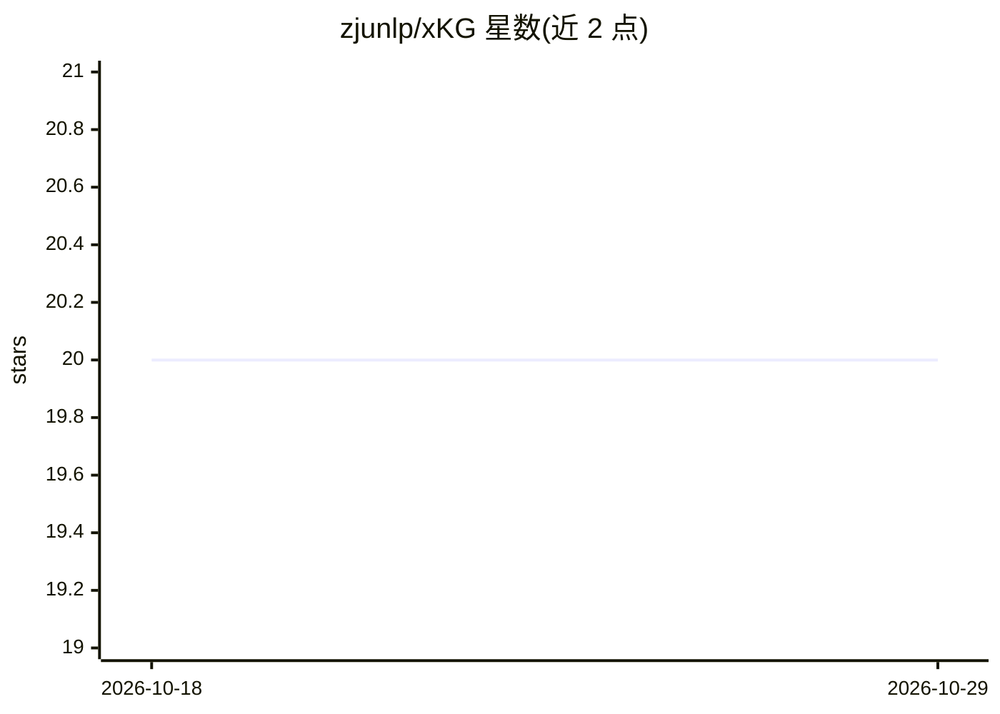

# zjunlp/xKG

⭐ 20 · Python · MIT · 推送 2026-07-09 · [GitHub](https://github.com/zjunlp/xKG) · 组织维护 · 中文 README

**面向论文复现的可执行知识图谱构建与检索框架**

xKG 是一个用于 AI 研究复现的知识图谱框架：以论文为中心，从科学文献中自动抽取技术节点与可执行代码节点，构建包含概念关系与代码组件的知识库；通过收集相关论文语料、提取实现级代码信号、验证代码可执行性来生成图谱，并支持按技术名称查询检索。框架可集成到 ReAct、迭代式 agent、代码生成器等 agent 框架中，在 PaperBench Code-Dev 上对多种 agent 与 LLM 后端组合给出评测结果。由浙江大学 NLP 团队（zjunlp）维护，配有 arXiv 论文（2510.17795，标注 ACL 2026）。安装需 Python 3.10+，配置 OpenAI 兼容 API 与 GitHub Token，嵌入支持本地（GPU 可选 faiss-gpu）或 API 两种模式，代码验证依赖可选 Docker。

## 筛选速览

| 维度 | 判定 | 备注 |
|---|---|---|
| AI 角色 | `ai-ecosystem` | LLM/agent 周边工具 |
| 许可风险 | `permissive` | MIT |
| 部署形态 | `library` | 以包/库形式分发 |
| 模型依赖 | — | README 未给出锁定关系 |
| 硬件要求 | — | 无带数字的原话,不猜 |
| 安装摩擦 | `low` | 无编译、无系统依赖或容器化 |
| 成熟度 | — | 结构信号不足 |

## 能力要点

- 从论文自动生成技术节点+可执行代码节点的层次化知识图谱
- 自动收集相关论文语料（top引用+技术检索）并过滤出有可执行代码的技术
- 集成 ReAct/迭代 agent/代码生成器等框架的规划与实现阶段
- 提供 PaperBench Code-Dev 评测环境与示例知识图谱

## 适用场景

- 为 LLM agent 复现 AI 论文提供代码级知识库
- 按技术描述检索相似技术与对应实现代码
- 在 PaperBench 上评测知识增强对论文复现的效果

## 场景标签

`知识图谱` `科研工具` `语义搜索` · 领域:知识与检索

## 证据(README 行号)

> L14: **xKG (Executable Knowledge Graphs)** solves this by automatically integrating code snippets and technical insights
> L24: 3. **Proven Integration Strategy** — Seamlessly integrates into diverse agent frameworks (ReAct, iterative agents, 
> L26: xKG demonstrates **substantial and consistent improvements** across three agent frameworks and two LLM backbones on

## 星数曲线

2026-10-18 20 → 2026-10-29 20（+0）

---
*卡片 v1 · prompt 1.4 · 生成 2026-10-28 · 置信度 mid · 依据 README sha `5d2e35fa7a9a` · [字段定义](../../DATASET.md)*
