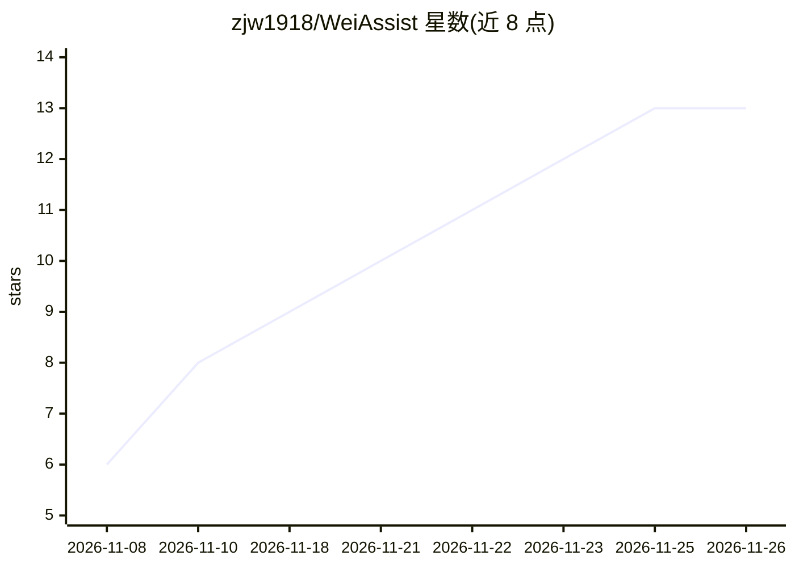

# zjw1918/WeiAssist

⭐ 13 · Kotlin · Apache-2.0 · 推送 2026-11-10 · [GitHub](https://github.com/zjw1918/WeiAssist) · 个人维护 · 中文 README

**在 Android 手机上替用户操作手机的开源 AI 代理应用**

WeiAssist（小维助手）是一个运行在 Android 手机上的开源 AI 代理，直接操作用户的应用、运行 Linux 命令、处理照片与文件，并支持多任务并行，无中间服务器，密钥保存在手机上。代理循环由内置的 Pi 或应用安装的 DeepSeek Harness 引擎执行；可选的 Gateway 应用把手机变成 AI 网关，向本机与局域网设备提供 OpenAI/Anthropic/Gemini 兼容 API。语音输入依赖用户自备的 Apple Silicon Mac 上运行的 MLX Whisper 服务器。风险操作前需用户确认。

## 筛选速览

| 维度 | 判定 | 备注 |
|---|---|---|
| AI 角色 | `ai-native` | 本体是模型或模型工具 |
| 许可风险 | `permissive` | Apache-2.0 |
| 部署形态 | `None` |  |
| 模型依赖 | local-ok | 支持本地模型 |
| 硬件要求 | — | 无带数字的原话,不猜 |
| 安装摩擦 | `medium` | 含编译或系统依赖之一 |
| 成熟度 | — | 结构信号不足 |

## 能力要点

- Pi（内置）与 DeepSeek Harness（Termux 安装）双引擎可选
- 通过无障碍服务操作手机应用，风险操作前请求确认
- 可选 Gateway 应用提供 OpenAI/Anthropic/Gemini 兼容的本地网关 API
- Telegram bot 远程对话与语音消息交互

## 适用场景

- 让 AI 代理代为操作手机上的应用（发邮件、查信息等）
- 在手机上用 Termux 写代码、跑数据任务
- 通过 Telegram 在远离手机时远程指挥手机
- 把手机作为局域网内的 AI 网关供多设备调用

## 场景标签

`GUI 自动化` `AI 助手` `模型网关` · 领域:Agent 开发

## 证据(README 行号)

> L12: WeiAssist is an open-source AI agent that operates your Android phone for you, with no server in between. It uses
> L3:  WeiAssist (小维助手), an open-source AI agent for Android. AI engines: Pi and DeepSeek Harness. Linux tools: Termux.
> L44: 1. Open WeiAssist and connect an AI provider: sign in with ChatGPT, SuperGrok or X Premium, or paste an API key.

## 星数曲线

2026-11-08 6 → 2026-11-26 13（+7）

---
*卡片 v1 · prompt 1.4 · 生成 2026-11-20 · 置信度 high · 依据 README sha `31b33eb91b4a` · [字段定义](../../DATASET.md)*
