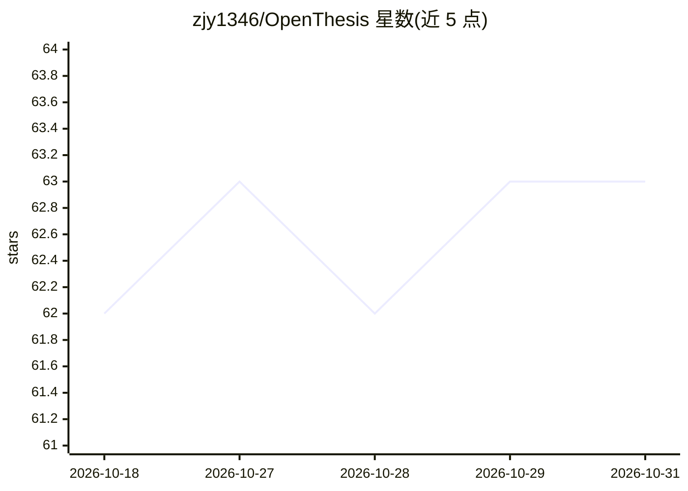

# zjy1346/OpenThesis

⭐ 63 · Python · Apache-2.0 · 推送 2026-10-28 · [GitHub](https://github.com/zjy1346/OpenThesis) · [官网](https://openthesis.cc.cd/) · 个人维护 · 中文 README

**面向长期投资者的开源 Windows 公司研究桌面应用**

Windows x64 桌面应用，为长期投资者做公司基本面研究：先从 SEC EDGAR、CNINFO、沪深北交易所、港交所披露文件中抽取并规范化证据，生成可溯源的确定性财务汇总，再由多个模型角色（财务、成长、反方论证、综合、验证等）基于同一份证据做分析推理。模型接入独立于研究页，内置 DeepSeek、Qwen/DashScope、Kimi、GLM、OpenAI、Gemini、OpenRouter、Ollama 及自定义兼容端点；API key 存于 Windows 凭据管理器。仅提供 Windows x64 官方二进制，源码运行需 Python 3.11+、Node.js、Rust 与 VC++ 构建工具。

## 筛选速览

| 维度 | 判定 | 备注 |
|---|---|---|
| AI 角色 | `ai-native` | 本体是模型或模型工具 |
| 许可风险 | `permissive` | Apache-2.0 |
| 部署形态 | `desktop` | 安装包/桌面程序 |
| 模型依赖 | local-ok | 支持本地模型 |
| 硬件要求 | — | 无带数字的原话,不猜 |
| 安装摩擦 | `low` | 无编译、无系统依赖或容器化 |
| 成熟度 | — | 结构信号不足 |

## 能力要点

- 证据先行：披露文件抽取→结构化财务事实→模型分析，模型不充当事实库
- Model Center 支持多提供商多连接，含 Ollama 本地端点
- 研究记录含模型引用、数据快照与哈希，可复现且不含密钥
- `.ot` 声明式研究包格式与 OT Studio 编辑器，确定性编译

## 适用场景

- 基于官方披露文件做可溯源的公司基本面研究
- 多模型对比分析同一家公司的财务与成长逻辑
- 本地 Ollama 端点下进行模型分析以控制数据外发

## 场景标签

`金融量化` `多智能体` · 领域:Agent 开发

## 证据(README 行号)

> L14: OpenThesis is an open-source Windows desktop application for long-term company research. It separates evidence coll
> L97: A study can select one primary model and zero or more comparison models. Financial, business-model, accounting-risk

## 星数曲线

2026-10-18 62 → 2026-10-31 63（+1）

---
*卡片 v1 · prompt 1.4 · 生成 2026-10-24 · 置信度 high · 依据 README sha `fe0cc493b1a9` · [字段定义](../../DATASET.md)*
