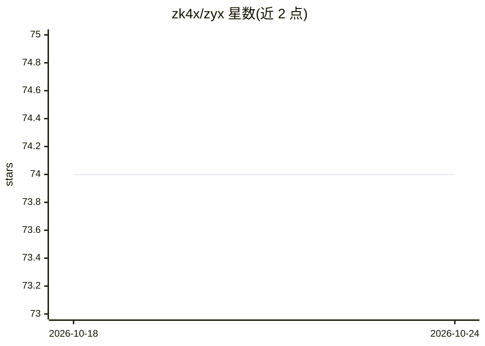

# zk4x/zyx

⭐ 74 · Rust · NOASSERTION · 推送 2026-10-21 · [GitHub](https://github.com/zk4x/zyx) · 个人维护

**面向多后端硬件的 Rust 张量/机器学习库**

用 Rust 编写（附 Python 绑定）的张量与神经网络库，目标是跨硬件运行线性代数与模型训练：以线性 IR 为硬件统一接口，通过 e-graph 融合与自动调优生成内核，后端覆盖 C、CUDA、OpenCL、Vulkan 与 WGPU，并支持自定义内核与 e-graph AOT 模式匹配。提供 zyx-nn 神经网络层与 zyx-optim 优化器 crate，编译后体积约几 MB，镜像 PyTorch ops API。Linux/macOS 为主要平台，Windows 尚在计划中，Tenstorrent 后端为初步支持。

## 筛选速览

| 维度 | 判定 | 备注 |
|---|---|---|
| AI 角色 | `ai-ecosystem` | LLM/agent 周边工具 |
| 许可风险 | `none` | NOASSERTION |
| 部署形态 | `library` | 以包/库形式分发 |
| 模型依赖 | — | README 未给出锁定关系 |
| 硬件要求 | — | 无带数字的原话,不猜 |
| 安装摩擦 | `medium` | 含编译或系统依赖之一 |
| 成熟度 | — | 结构信号不足 |

## 能力要点

- 线性 IR + e-graph 融合与自动调优，一份小代码生成文件对应一个后端
- 后端覆盖 C/CUDA/OpenCL/Vulkan/WGPU（SPIR-V）
- 支持自定义内核（zyx IR 或外部二进制/cublas/cblas），e-graph 择优
- 编译库仅约 5 MB、两个依赖，训练与部署共用同一 API

## 适用场景

- 在 GPU/CPU/WebGPU 等异构设备上训练和运行神经网络
- 为新兴硬件快速接入一套张量与 autograd 栈
- 手写或模式匹配自定义内核以利用 tensor core 等特性
- 用 Python 绑定以 PyTorch 风格 API 进行张量计算

## 场景标签

 · 领域:深度学习/张量计算库

## 证据(README 行号)

> L3: **ML library for your hardware**
> L70: |`zyx`|Core tensor library with all backends and autodiff|

## 星数曲线

2026-10-18 74 → 2026-10-24 74（+0）

---
*卡片 v1 · prompt 1.4 · 生成 2026-10-24 · 置信度 high · 依据 README sha `ed888d9a70ff` · [字段定义](../../DATASET.md)*
