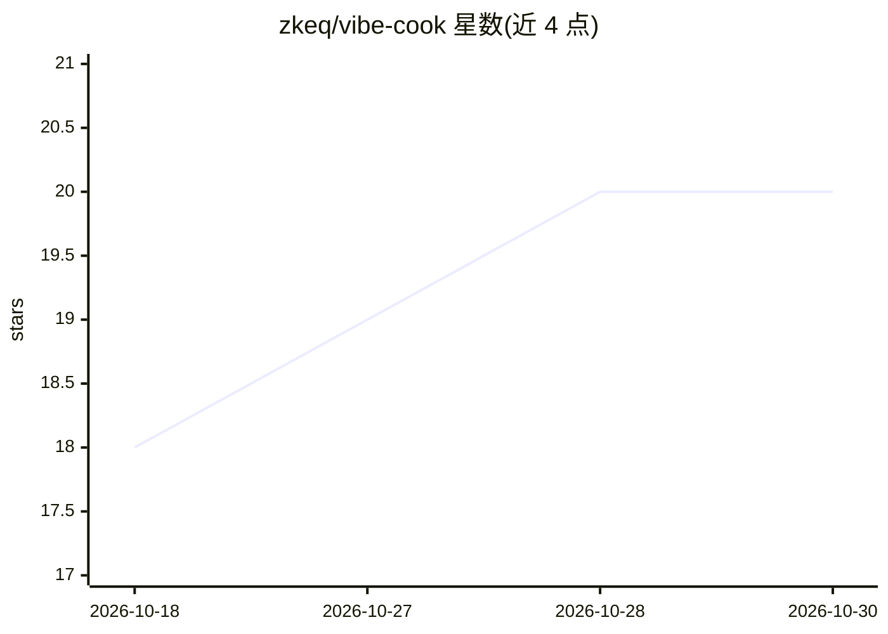

# zkeq/vibe-cook

⭐ 20 · TypeScript · NOASSERTION · 推送 2026-10-27 · [GitHub](https://github.com/zkeq/vibe-cook) · [官网](https://cook.corerevive.cn) · 个人维护 · 中文 README

**沉浸式一步步烹饪 App：把 HowToCook 菜谱变成跟做体验**

基于 Next.js + PWA 的烹饪应用，将社区项目 HowToCook 的 Markdown 菜谱经 LLM 结构化为 JSON 分步数据并生成配图。提供食谱墙、全解图、全屏单步烹饪模式、购物清单份量缩放等功能。AI 部分：基于 sherpa-onnx WASM 的本机关键词语音控制（约 17MB 模型离线运行）、调用 DeepSeek 官方 API 的选菜与厨师 Agent（可选，未配 Key 返回 503，不影响其他功能）。应用代码为 BSL-1.1，2030-08-19 起转 GPL v2+；结构化数据集为 The Unlicense。

## 筛选速览

| 维度 | 判定 | 备注 |
|---|---|---|
| AI 角色 | `ai-enhanced` | 去掉 AI 部分产品仍成立 |
| 许可风险 | `none` | NOASSERTION |
| 部署形态 | `library` | 以包/库形式分发 |
| 模型依赖 | locked-api |  |
| 硬件要求 | — | 无带数字的原话,不猜 |
| 安装摩擦 | `low` | 无编译、无系统依赖或容器化 |
| 成熟度 | — | 结构信号不足 |

## 能力要点

- 全屏单步烹饪模式：计时器、完成打勾、屏幕常亮
- sherpa-onnx 本机关键词识别语音控制（WASM 离线运行，不上传录音）
- LLM 结构化 HowToCook 菜谱为 JSON + 配图，以 Unlicense 开放回馈社区
- AI 选菜 / 厨师 Agent，调用 DeepSeek 官方 API，未配置时其余功能不受影响

## 适用场景

- 灶台边跟着一步步做菜，全屏显示当前步骤
- 手上有油时用语音指令翻步骤、看配料表
- 告诉 AI 冰箱里有什么，让它配今晚的菜
- 按菜生成购物清单并自动缩放份量

## 场景标签

`语音识别` · 领域:感知与多模态

## 证据(README 行号)

> L38: |🎙️|**语音控制**|手上有油不用碰屏幕：说「下一步」翻步骤，说「配料表」全屏看用量，本机识别不上传|
> L40: |🥗|**AI 选菜**|告诉它冰箱里有什么，帮你配今晚吃什么|
> L128: 首页有 **选菜 Agent**，详情 / 烹饪页有带上下文的 **厨师 Agent**。

## 星数曲线

2026-10-18 18 → 2026-10-30 20（+2）

---
*卡片 v1 · prompt 1.4 · 生成 2026-10-28 · 置信度 high · 依据 README sha `fea81fb1d02b` · [字段定义](../../DATASET.md)*
