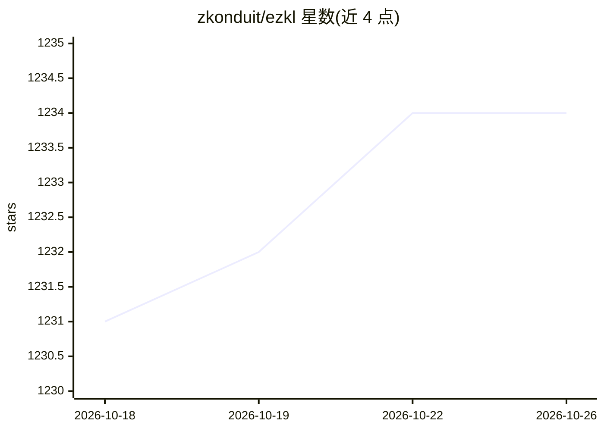

# zkonduit/ezkl

⭐ 1,234 · Rust · 推送 2026-02-20 · [GitHub](https://github.com/zkonduit/ezkl) · [官网](https://docs.ezkl.xyz/) · 组织维护

**在 zk-SNARK 中执行深度学习模型推理的证明引擎（ZKML）**

面向开发者的 ZKML 库与命令行工具：读取 ONNX 计算图与 JSON 样例输入，基于 Halo2 证明系统生成 ZK-SNARK 电路，可证明『在私有/公开数据上正确运行某模型并得到该输出』等语句；生成的证明可在链上（EVM）、浏览器或设备上低成本验证。提供 pip 安装的 Python 绑定、curl 脚本安装的 CLI 与 cargo 源码构建，支持 NVIDIA GPU 加速（Icicle）。限制：电路量化导致输出与 Python 略有差异。

## 筛选速览

| 维度 | 判定 | 备注 |
|---|---|---|
| AI 角色 | `ai-ecosystem` | LLM/agent 周边工具 |
| 许可风险 | `none` | — |
| 部署形态 | `library` | 以包/库形式分发 |
| 模型依赖 | — | README 未给出锁定关系 |
| 硬件要求 | — | 无带数字的原话,不猜 |
| 安装摩擦 | `low` | 无编译、无系统依赖或容器化 |
| 成熟度 | — | 结构信号不足 |

## 能力要点

- 读取 ONNX 图生成 ZK-SNARK 电路（后端 Halo2）
- 证明可在 EVM 链上、浏览器或设备上验证
- 支持三种使用方式：Python、JavaScript、命令行
- NVIDIA GPU 加速（Icicle feature），v21.0.0 经 Trail of Bits 审计

## 适用场景

- 证明我在私有数据上运行了公开模型并得到该输出
- 把模型推理验证器部署到链上供智能合约使用
- 证明私有模型的推理结果正确而不泄露模型

## 场景标签

 · 领域:密码学/AI 可验证推理

## 证据(README 行号)

> L9: `ezkl` is a library and command-line tool for doing inference for deep learning models and other computational graph
> L29: The generated proofs can then be verified with much less computational resources, including on-chain (with the Ethe

## 星数曲线

2026-10-18 1,231 → 2026-10-26 1,234（+3）

---
*卡片 v1 · prompt 1.4 · 生成 2026-10-21 · 置信度 high · 依据 README sha `a371929c1531` · [字段定义](../../DATASET.md)*
