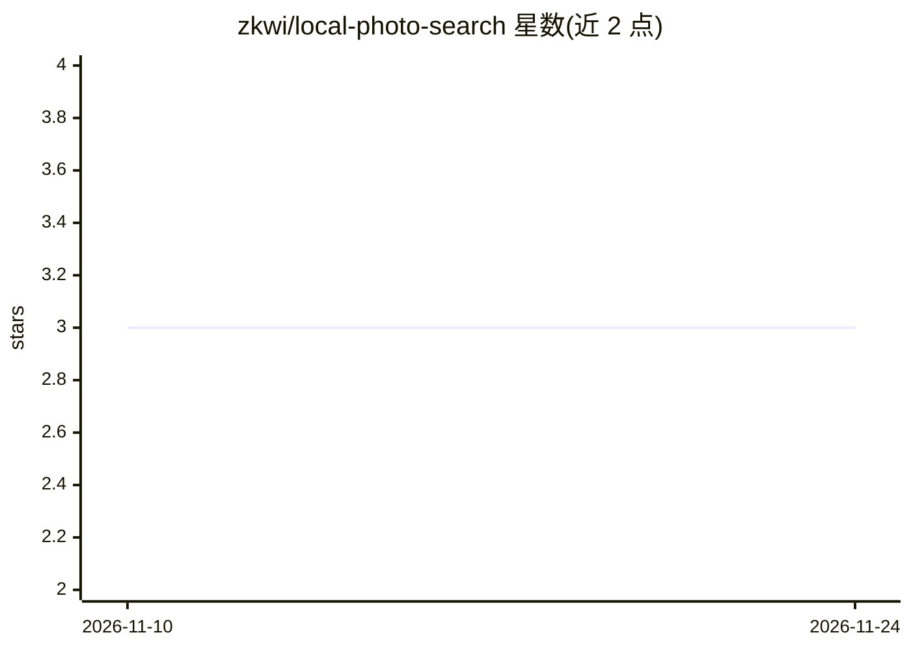

# zkwi/local-photo-search

⭐ 3 · JavaScript · MIT · 推送 2026-10-08 · [GitHub](https://github.com/zkwi/local-photo-search) · [官网](https://github.com/zkwi/local-photo-search/releases/latest) · 个人维护 · 中文 README

**本地离线桌面应用：用自然语言在个人电脑上搜照片**

开源 Windows 桌面应用，使用 Google EmbeddingGemma 2 多模态嵌入模型在本机检索照片：支持文本描述搜图、以图搜图、相似照片查找、重复/连拍分组清理、按月浏览与预览管理。照片与索引均不上传，首次启动自动下载 Python、PyTorch 与约 1.5 GB 模型，此后可完全离线运行；可选 NVIDIA GPU 加速首次索引，无 GPU 时回退 CPU。界面支持英文与简体中文。

## 筛选速览

| 维度 | 判定 | 备注 |
|---|---|---|
| AI 角色 | `ai-native` | 本体是模型或模型工具 |
| 许可风险 | `permissive` | MIT |
| 部署形态 | `desktop` | 安装包/桌面程序 |
| 模型依赖 | — | README 未给出锁定关系 |
| 硬件要求 | — | 无带数字的原话,不猜 |
| 安装摩擦 | `low` | 无编译、无系统依赖或容器化 |
| 成熟度 | — | 结构信号不足 |

## 能力要点

- 文本语义搜图，查询中的日期词自动转为日期过滤
- 以图搜图（拖放/粘贴）与相似照片查找
- 重复照片、近重复与连拍分组审查，应用自身不删除文件
- 基于 768 维向量的矩阵运算检索，全库打分单次完成

## 适用场景

- 在本地大容量照片库中用一句话找到场景/物体照片
- 不联网、不上云的前提下整理和检索私人照片
- 清理聊天软件保存的压缩副本等近重复照片
- 中文描述搜索照片库（如「去年5月 海边」）

## 场景标签

`语义搜索` · 领域:知识与检索

## 证据(README 行号)

> L11: **Local Photo Search** is a free, open-source desktop app that finds photos on your own computer by what is in them
> L52: - encodes **images and text with one multimodal model**, so a sentence can be compared directly with every photo;
> L145: - **Retrieval**: EmbeddingGemma 2 encodes every photo once into a 768-dimensional vector. A search encodes the que

## 星数曲线

2026-11-10 3 → 2026-11-24 3（+0）

---
*卡片 v1 · prompt 1.4 · 生成 2026-11-21 · 置信度 high · 依据 README sha `eed7908ed6fe` · [字段定义](../../DATASET.md)*
