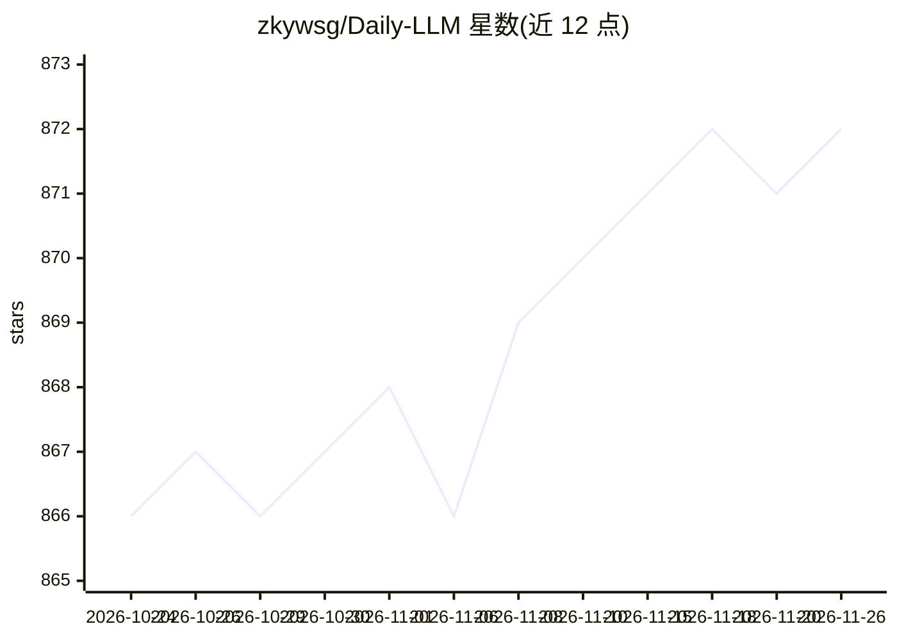

# zkywsg/Daily-LLM

⭐ 872 · TypeScript · MIT · 推送 2026-11-25 · [GitHub](https://github.com/zkywsg/Daily-LLM) · 个人维护 · 中文 README

**从零系统学机器学习/深度学习/大模型的教学仓库**

以 6 层、45 个知识块、191 个知识点的大纲组织学习内容，每个知识点计划产出讲解 Markdown、浏览器互动页与竖版图卡三种素材。目前仅完成大模型注意力系列的 13 个知识点，其余标注待写。讲解可在 GitHub 或静态站点直接读，互动页为纯前端页面；本地构建需 Node 20+，运行代码示例需 numpy 或 torch/transformers。示例为教学用玩具模型，注意力真实模型脚本未运行过。

## 筛选速览

| 维度 | 判定 | 备注 |
|---|---|---|
| AI 角色 | `ai-knowledge` | 知识聚合/清单类 |
| 许可风险 | `permissive` | MIT |
| 部署形态 | `library` | 以包/库形式分发 |
| 模型依赖 | — | README 未给出锁定关系 |
| 硬件要求 | — | 无带数字的原话,不猜 |
| 安装摩擦 | `low` | 无编译、无系统依赖或容器化 |
| 成熟度 | `idea` | |

## 能力要点

- 6 层、45 个知识块、191 个知识点的完整学习大纲
- 每知识点产出讲解 Markdown、互动页与图卡三种素材
- 已完成注意力系列 13 篇，含 KV cache/GQA/FlashAttention
- 互动页为纯前端，可离线双击打开

## 适用场景

- 按大纲从零系统学习大模型与注意力机制
- 在浏览器里交互式操作公式与数值演示
- 作为机器学习/深度学习面试与自学路线参考

## 场景标签

`教程课程` · 领域:学习与行业

## 证据(README 行号)

> L21: 目标只有一个：**从零开始，把机器学习、深度学习、大模型的全部知识系统地学一遍，并把学的过程完整呈现在这个仓库里。**
> L23: 整个仓库按一个大框架组织：6 层、45 个知识块、191 个知识点，从数学与工具一路到大模型和工程系统（完整大纲在下面）。每个知识点计划产出三样东西，来自同一份源：
> L29: **目前进度：191 个知识点里已完成 13 个**，全部在“大模型 → 注意力系列”。其余按大纲顺序逐步补齐；每一项的状态和旧版素材位置都记录在 learn/roadmap.json。

## 星数曲线

2026-10-24 866 → 2026-11-26 872（+6）

---
*卡片 v1 · prompt 1.4 · 生成 2026-11-26 · 置信度 mid · 依据 README sha `d7b3387f577f` · [字段定义](../../DATASET.md)*
