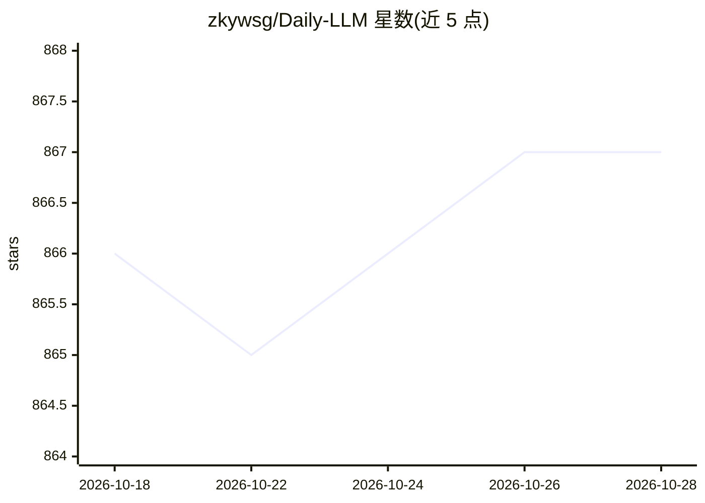

# zkywsg/Daily-LLM

⭐ 866 · TypeScript · MIT · 推送 2026-09-25 · [GitHub](https://github.com/zkywsg/Daily-LLM) · 个人维护 · 中文 README

**深度学习与大模型学习路线仓库：19 个架构家族的系统教程**

面向学习者的深度学习与大模型教程仓库：按 19 个架构家族（CNN、RNN、Transformer、BERT、GPT、扩散模型、PEFT/LoRA、RLHF、MoE、RAG/Agent、推理模型等）组织 1986–2025 年的演进时间线，附横切基础（激活、反传、优化器、注意力机制）与跨家族实战项目目录，中英双语。仓库内含一个本地可视化时间线网页（web/，npm 运行），另有 TIMELINE.md 自动生成的按年份索引。Python 3.8+，MIT 许可。

## 筛选速览

| 维度 | 判定 | 备注 |
|---|---|---|
| AI 角色 | `ai-knowledge` | 知识聚合/清单类 |
| 许可风险 | `permissive` | MIT |
| 部署形态 | `library` | 以包/库形式分发 |
| 模型依赖 | — | README 未给出锁定关系 |
| 硬件要求 | — | 无带数字的原话,不猜 |
| 安装摩擦 | `low` | 无编译、无系统依赖或容器化 |
| 成熟度 | — | 结构信号不足 |

## 能力要点

- 19 个架构家族（1986–2025）按时间线组织
- 横切基础目录覆盖激活、反传、优化器、注意力机制
- 内置本地可视化时间线网页（web/）
- 中英双语，含 TIMELINE.md 按年份自动索引

## 适用场景

- 系统学习从 CNN 到推理模型的深度学习与大模型知识
- 按家族查阅某个架构范式的演进脉络
- 跨家族实战项目练习

## 场景标签

`教程课程` · 领域:学习与行业

## 证据(README 行号)

> L3: # 深度学习与大模型精通之路
> L7:  深度学习与大模型的可视化学习路线 —— 从 1986 年 RNN 到 2025 年推理模型，按 19 个架构家族梳理演进脉络。
> L69: - `01-cnn/` … `19-recommendation/` — 19 个架构/范式家族

## 星数曲线

2026-10-18 866 → 2026-10-28 867（+1）

---
*卡片 v1 · prompt 1.4 · 生成 2026-10-21 · 置信度 high · 依据 README sha `7cb710889adf` · [字段定义](../../DATASET.md)*
