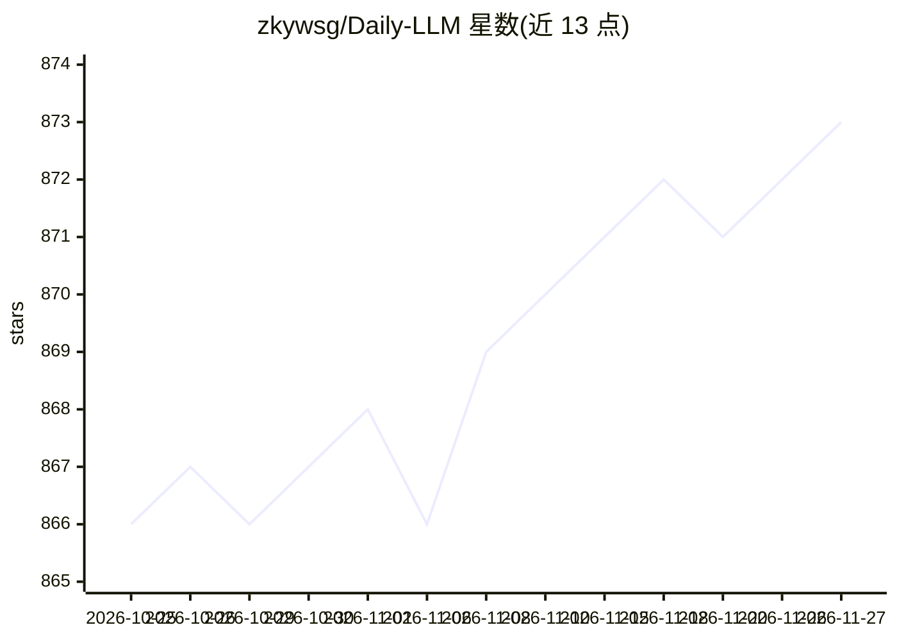

# zkywsg/Daily-LLM

⭐ 873 · TypeScript · MIT · 推送 2026-11-26 · [GitHub](https://github.com/zkywsg/Daily-LLM) · 个人维护 · 中文 README

**从零系统学习机器学习/深度学习/大模型的教学仓库**

以 6 层、45 个知识块、191 个知识点的大纲组织机器学习、深度学习与大模型知识，每个知识点计划产出 Markdown 讲解、浏览器互动页与竖版图卡三类内容，进度记录在 learn/roadmap.json。目前完成 17 个知识点（注意力系列 13 篇、Transformer 完整模型 4 篇），示例均为教学用玩具模型。提供在线站点阅读，本地预览需 Node 20+，跑代码仅需 numpy，可选 torch 与 transformers。

## 筛选速览

| 维度 | 判定 | 备注 |
|---|---|---|
| AI 角色 | `ai-knowledge` | 知识聚合/清单类 |
| 许可风险 | `permissive` | MIT |
| 部署形态 | `library` | 以包/库形式分发 |
| 模型依赖 | — | README 未给出锁定关系 |
| 硬件要求 | — | 无带数字的原话,不猜 |
| 安装摩擦 | `low` | 无编译、无系统依赖或容器化 |
| 成熟度 | — | 结构信号不足 |

## 能力要点

- 6 层 45 知识块 191 知识点的完整学习大纲
- 每个知识点配套讲解、浏览器互动页与图卡
- 迷你 GPT 用 NumPy 手写反向传播从零训练（2.75 万参数）
- 注意力系列含 KV cache/GQA/FlashAttention 等高效注意力篇目

## 适用场景

- 从零系统学习注意力机制与 Transformer 结构
- 在浏览器互动页中动手观察注意力计算
- 按大纲规划机器学习到大模型的学习路线
- 查阅 19 个模型架构家族的时间线速查资料

## 场景标签

`教程课程` · 领域:学习与行业

## 证据(README 行号)

> L21: 目标只有一个：**从零开始，把机器学习、深度学习、大模型的全部知识系统地学一遍，并把学的过程完整呈现在这个仓库里。**
> L23: 整个仓库按一个大框架组织：6 层、45 个知识块、191 个知识点，从数学与工具一路到大模型和工程系统（完整大纲在下面）。每个知识点计划产出三样东西，来自同一份源：
> L29: **目前进度：191 个知识点里已完成 17 个**，都在“大模型”层：注意力系列（13 篇）和 Transformer 完整模型（4 篇）。其余按大纲顺序逐步补齐；每一项的状态和旧版素材位置都记录在 learn/roadmap.

## 星数曲线

2026-10-25 866 → 2026-11-27 873（+7）

---
*卡片 v1 · prompt 1.4 · 生成 2026-11-27 · 置信度 mid · 依据 README sha `798af66c025f` · [字段定义](../../DATASET.md)*
