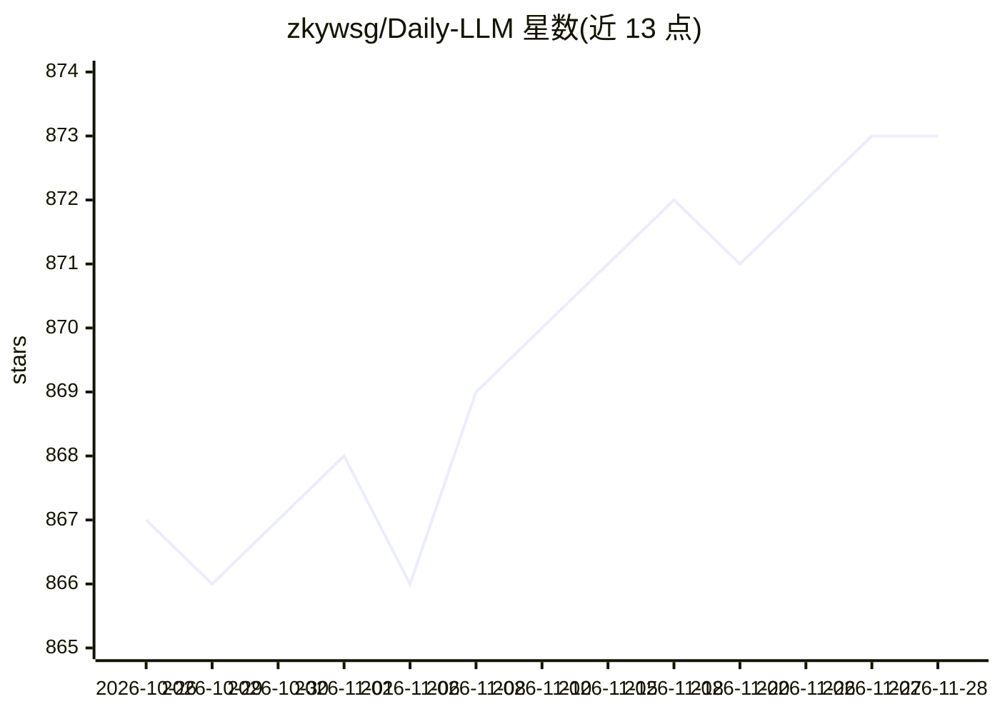

# zkywsg/Daily-LLM

⭐ 873 · TypeScript · MIT · 推送 2026-11-27 · [GitHub](https://github.com/zkywsg/Daily-LLM) · 个人维护 · 中文 README

**从零系统学机器学习/深度学习/大模型的开源教程仓库**

按 6 层 45 个知识块、191 个知识点的大纲组织的学习仓库，每个知识点计划产出 Markdown 讲解、浏览器互动页与图卡三种形式。目前完成 22 个知识点共 21 篇，集中在线性代数与注意力/Transformer 系列；示例为教学用玩具模型，注意力系列真实模型脚本未在真实模型上运行。可在线阅读，Node 20+ 可本地构建整页预览，多数代码仅需 numpy。

## 筛选速览

| 维度 | 判定 | 备注 |
|---|---|---|
| AI 角色 | `ai-knowledge` | 知识聚合/清单类 |
| 许可风险 | `permissive` | MIT |
| 部署形态 | `library` | 以包/库形式分发 |
| 模型依赖 | — | README 未给出锁定关系 |
| 硬件要求 | — | 无带数字的原话,不猜 |
| 安装摩擦 | `low` | 无编译、无系统依赖或容器化 |
| 成熟度 | `idea` | |

## 能力要点

- 6 层 45 个知识块、191 个知识点的完整学习大纲，进度记录于 roadmap.json
- 每个知识点产出讲解、互动页、图卡三种形式
- 21 篇已完成：线性代数 4 篇、注意力系列 13 篇、Transformer 模型 4 篇
- 从零训练的迷你 GPT（NumPy 手写反向传播）与注意力从零实现

## 适用场景

- 系统自学从数学基础到大模型的知识体系
- 浏览器互动页里动手理解注意力与 LayerNorm 等机制
- 参考从零用 NumPy 实现迷你 GPT 的教学代码

## 场景标签

`教程课程` · 领域:学习与行业

## 证据(README 行号)

> L21: 目标只有一个：**从零开始，把机器学习、深度学习、大模型的全部知识系统地学一遍，并把学的过程完整呈现在这个仓库里。**
> L23: 整个仓库按一个大框架组织：6 层、45 个知识块、191 个知识点，从数学与工具一路到大模型和工程系统（完整大纲在下面）。每个知识点计划产出三样东西，来自同一份源：

## 星数曲线

2026-10-26 867 → 2026-11-28 873（+6）

---
*卡片 v1 · prompt 1.4 · 生成 2026-11-28 · 置信度 mid · 依据 README sha `62a206583ee6` · [字段定义](../../DATASET.md)*
