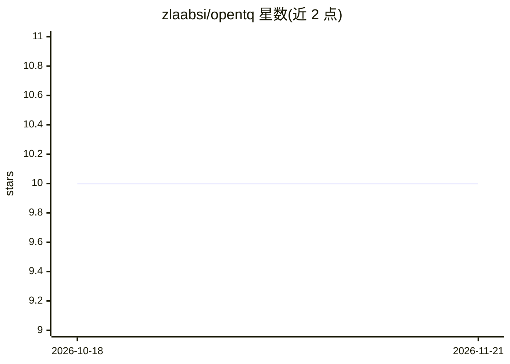

# zlaabsi/opentq

⭐ 10 · Python · NOASSERTION · 推送 2026-05-05 · [GitHub](https://github.com/zlaabsi/opentq) · [官网](https://huggingface.co/zlaabsi/Qwen3.6-27B-OTQ-GGUF) · 个人维护

**面向开发者的低比特 LLM 量化实验与发布工具集**

OpenTQ 是一个低比特权重格式的量化实验工具，将量化流程组织为可审计的发布过程：通过 CLI 规划张量精度分配、生成 GGUF 工件与 quantize.sh、运行 llama.cpp/Metal 运行时门控、发布配对 BF16-vs-GGUF 回归信号与可复现数据集。用户提供 YAML/JSON 自定义分配策略，经终端仪表盘监控长任务。公共路线使用 llama.cpp 支持的标准 GGUF 张量类型；原生 .otq 打包格式与自定义 Metal 运行时为单独的本地受限研究线。要求 Python 3.11+。

## 筛选速览

| 维度 | 判定 | 备注 |
|---|---|---|
| AI 角色 | `ai-ecosystem` | LLM/agent 周边工具 |
| 许可风险 | `none` | NOASSERTION |
| 部署形态 | `None` |  |
| 模型依赖 | local-ok | 支持本地模型 |
| 硬件要求 | — | 无带数字的原话,不猜 |
| 安装摩擦 | `low` | 无编译、无系统依赖或容器化 |
| 成熟度 | — | 结构信号不足 |

## 能力要点

- 按张量族分配 GGUF 量化类型并发布分配映射表供审计
- 内置 Q3/Q4/Q5 动态 GGUF 策略，支持 YAML/JSON 自定义分配政策
- 配对 BF16-vs-GGUF 迷你子集质量信号，附公开可复现基准数据集
- 终端监控仪表盘与机器可读状态输出，跟踪长量化任务

## 适用场景

- 为 Qwen 类模型生成可直接在 llama.cpp 运行的低比特 GGUF 发布物
- 按自定义策略决定模型各张量族的精度分配
- 发布量化模型前运行本地运行时门控与回归评估
- 审计量化发布中精度具体花在哪些张量上

## 场景标签

`模型量化` `模型评测` `推理引擎` · 领域:评测与运维

## 证据(README 行号)

> L30: `OpenTQ` is an open quantization lab for low-bit weight formats. It turns quantization from an opaque "one setting 
> L44: - **Custom policies:** users can define their own dynamic allocation policy with YAML/JSON via `--policy-file`.
> L58: OpenTQ's stock-compatible path supports custom **allocation** policies, not arbitrary new GGUF kernels. You can cho

## 星数曲线

2026-10-18 10 → 2026-11-21 10（+0）

---
*卡片 v1 · prompt 1.4 · 生成 2026-11-19 · 置信度 high · 依据 README sha `525fe1963b2b` · [字段定义](../../DATASET.md)*
